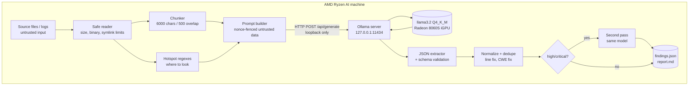
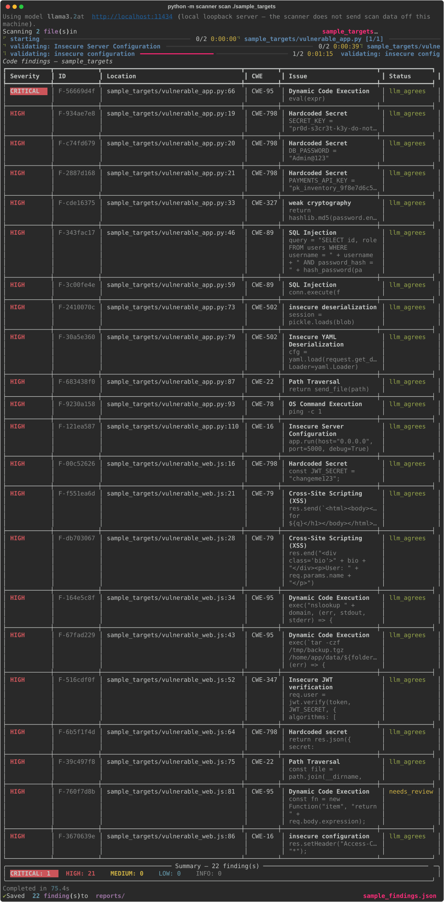

# amd-vuln-scanner

[](https://github.com/zhakimi/local-llm-vuln-detection/actions/workflows/ci.yml)


[](LICENSE)

**Local LLM-powered vulnerability detection and security log analysis on AMD Ryzen AI hardware, using Python and Ollama.**

`amd-vuln-scanner` is a command-line tool that asks a local language model,
served by [Ollama](https://ollama.com) on the same machine, to find
vulnerabilities in source code (Python, JavaScript, TypeScript, Java, C) and
attack activity in system/web logs. It ships with a labeled benchmark that
measures how well it works compared with Semgrep, and the numbers below are
the measured results, including where it falls short.

---

## Contents

1. [Why](#why) · 2. [Hardware & software](#hardware--software-environment) · 3. [Architecture](#architecture) ·
4. [Install](#installation) · 5. [Usage](#usage) · 6. [Capabilities](#detection-capabilities) ·
7. [Sample output](#sample-output) · 8. [Benchmark method](#benchmark-methodology) · 9. [Results](#benchmark-results) ·
10. [Limitations](#limitations-and-false-positives) · 11. [Privacy & security](#privacy-and-security) ·
12. [Roadmap](#future-improvements) · 13. [License](#license-and-acknowledgments)

## Why

Source code and server logs are often exactly what you should not paste into
a cloud chatbot. Laptop-class AMD Ryzen AI machines have enough unified memory
and integrated-GPU throughput to run useful models locally. This project asks
two questions:

1. Can a small local model do practical security triage of code and logs on
   such a machine?
2. How does it compare, measurably, with a conventional static analyzer?

## Hardware & software environment

Everything in the results section was measured on this machine:

| Component | Value |
|---|---|
| CPU | AMD RYZEN AI MAX+ 395 w/ Radeon 8060S (Strix Halo) |
| GPU | Radeon 8060S integrated graphics (shared unified memory) |
| NPU | AMD XDNA NPU (present; **not used**, since Ollama does not run on it) |
| Memory | 125 GiB unified memory (shared by CPU and GPU) |
| OS | AMD Ryzen AI Developer Platform 1 (rex), kernel 7.2.7+rex-amd64 |
| Ollama | 0.40.15 (bundles ROCm 7.2 and Vulkan backends) |
| Model | `llama3.2` (3.2B parameters, Q4_K_M GGUF, digest `a80c4f17acd5…`) |
| Inference settings | temperature 0.1, `num_ctx` 8192, `num_predict` 2048, JSON mode, no fixed seed |
| Placement | `ollama ps` → `3.1 GB  100% GPU  8192 context` |

Ollama reports the model as fully offloaded to the GPU. Whether it chose the
ROCm or the Vulkan backend could not be confirmed without root access to the
server logs, so this README doesn't claim either.

## Architecture



```
scanner/
├── cli.py            argparse CLI: scan, scan-logs, gen-tests, report
├── analyzer.py       Ollama client, chunking, hotspots, JSON extraction, dedupe, validation
├── prompts.py        prompt templates (code, logs, focused passes, validation, test generation)
├── reporter.py       rich terminal output, findings.json, report.md
├── safety.py         loopback guard, safe file reading, prompt-injection hygiene
├── schemas.py        JSON Schemas for model responses and findings.json
└── logging_utils.py  structured (key=value or JSON) logging, metadata only
benchmarks/           labeled synthetic benchmark, runner, baselines, reports
tests/                pytest suite (Ollama mocked; runs in CI without a GPU)
```

## Installation

Requirements: Linux, Python ≥ 3.10, [Ollama](https://ollama.com).

```bash
git clone https://github.com/zhakimi/local-llm-vuln-detection.git
cd local-llm-vuln-detection
python3 -m venv .venv && source .venv/bin/activate
chmod +x setup.sh && ./setup.sh
```

`setup.sh` installs Ollama (skipped if present), starts `ollama serve` if it
isn't running, pulls `llama3.2`, and installs `requests` and `rich`. It runs
Ollama's official install script (`curl -fsSL https://ollama.com/install.sh | sh`),
so read that script first if you prefer. For the full dependency set:

```bash
pip install -r requirements.txt            # runtime
pip install -r requirements-dev.txt        # tests + lint
pip install semgrep                        # only for the benchmark baseline
```

## Usage

```bash
python -m scanner scan ./sample_targets                      # code → reports/findings.json
python -m scanner scan-logs ./sample_targets/sample.log      # logs → reports/log_findings.json
python -m scanner gen-tests reports/findings.json            # candidate tests (never executed)
python -m scanner report reports/findings.json               # → reports/report.md
```

| Option | Effect |
|---|---|
| `--model qwen2.5-coder:7b` | any Ollama model (env `AMD_SCANNER_MODEL`) |
| `--host URL` / `--allow-remote-host` | Ollama URL; non-loopback hosts are refused unless explicitly allowed |
| `--temperature`, `--num-ctx`, `--seed` | inference settings |
| `--max-file-size N`, `--follow-symlinks` | file safety limits (default 1 MB, symlinks skipped) |
| `--no-hotspots`, `--no-validate` | disable the regex-guided passes / second pass |
| `--merge`, `--fail-on high`, `-o PATH` | combine reports, CI exit code, output path |
| `--log-level INFO --log-json --log-file F` | structured logs (metadata only, never code) |

Exit codes: `0` ok · `1` findings at/above `--fail-on` · `2` bad input or remote host refused · `3` Ollama unavailable
(`Ollama is not running. Run setup.sh first.`).

## Detection capabilities

| Area | Examples |
|---|---|
| Injection | SQL (string-built queries), OS command (`shell=True`, `exec`, `system()`), code (`eval`, `new Function`) |
| Web | reflected / DOM XSS, path traversal, permissive CORS with credentials |
| Data handling | `pickle`, `yaml.load`, Java `ObjectInputStream`, `node-serialize` |
| Secrets & crypto | hardcoded passwords/keys, MD5/SHA-1 passwords, DES/ECB, `random`/`Math.random` tokens |
| AuthN | JWT `none` algorithm, disabled signature verification |
| Config | debug mode, disabled TLS verification, trust-all certificates |
| C | `strcpy`, `gets`, format strings |
| Logs | brute force, a successful login after failures, SQLi/XSS/traversal/command payloads, scanners, privilege escalation, web shells |

It also flags comments that look like instructions aimed at an AI reviewer
(prompt injection) as warnings.

## Sample output

<!-- SAMPLE_OUTPUT:START -->
Real output of `python -m scanner scan ./sample_targets` (llama3.2 on the Radeon 8060S). Full run: [`docs/sample_scan.txt`](docs/sample_scan.txt); rendered screenshot:



```text
Using model llama3.2 at http://localhost:11434 (local loopback server — the scanner does not send scan data off this 
machine).
Scanning 2 file(s) in sample_targets …
⠋ starting ━━━━━━━━━━━━━━━━━━━━━━━━━━━━━━━━━━━━━━━━ 0/2 0:00:00⠙ sample_targets/vulnerable_app.py [1/1] ━━━━━━━━━━━━━━━━━━━━━━━━━━━━━━━━━━━━━━━━ 0/2 0:00:00⠹ sample_targets/vulnerable_app.py [1/1] ━━━━━━━━━━━━━━━━━━━━━━━━━━━━━━━━━━━━━━━━ 0/2 0:00:00⠸ sample_targets/vulnerable_app.py [1/1] ━━━━━━━━━━━━━━━━━━━━━━━━━━━━━━━━━━━━━━━━ 0/2 0:00:00⠴ sample_targets/vulnerable_app.py [1/1] ━━━━━━━━━━━━━━━━━━━━━━━━━━━━━━━━━━━━━━━━ 0/2 0:00:00⠦ sample_targets/vulnerable_app.py [1/1] ━━━━━━━━━━━━━━━━━━━━━━━━━━━━━━━━━━━━━━━━ 0/2 0:00:00⠧ sample_targets/vulnerable_app.py [1/1] ━━━━━━━━━━━━━━━━━━━━━━━━━━━━━━━━━━━━━━━━ 0/2 0:00:00⠇ sample_targets/vulnerable_app.py [1/1] ━━━━━━━━━━━━━━━━━━━━━━━━━━━━━━━━━━━━━━━━ 0/2 0:00:00⠋ sample_targets/vulnerable_app.py [1/1] ━━━━━━━━━━━━━━━━━━━━━━━━━━━━━━━━━━━━━━━━ 0/2 0:00:00⠙ sample_targets/vulnerable_app.py [1/1] ━━━━━━━━━━━━━━━━━━━━━━━━━━━━━━━━━━━━━━━━ 0/2 0:00:00⠹ sample_targets/vulnerable_app.py [1/1] ━━━━━━━━━━━━━━━━━━━━━━━━━━━━━━━━━━━━━━━━ 0/2 0:00:01⠸ sample_targets/vulnerable_app.py [1/1] ━━━━━━━━━━━━━━━━━━━━━━━━━━━━━━━━━━━━━━━━ 0/2 0:00:01⠴ sample_targets/vulnerable_app.py [1/1] ━━━━━━━━━━━━━━━━━━━━━━━━━━━━━━━━━━━━━━━━ 0/2 0:00:01⠦ sample_targets/vulnerable_app.py [1/1] ━━━━━━━━━━━━━━━━━━━━━━━━━━━━━━━━━━━━━━━━ 0/2 0:00:01⠧ sample_targets/vulnerable_app.py [1/1] ━━━━━━━━━━━━━━━━━━━━━━━━━━━━━━━━━━━━━━━━ 0/2 0:00:01⠏ sample_targets/vulnerable_app.py [1/1] ━━━━━━━━━━━━━━━━━━━━━━━━━━━━━━━━━━━━━━━━ 0/2 0:00:01⠋ sample_targets/vulnerable_app.py hotspot 1/10 ━━━━━━━━━━━━━━━━━━━━━━━━━━━━━━━━━━━━━━━━ 0/2 0:00:01⠙ sample_targets/vulnerable_app.py hotspot 1/10 ━━━━━━━━━━━━━━━━━━━━━━━━━━━━━━━━━━━━━━━━ 0/2 0:00:01⠹ sample_targets/vulnerable_app.py hotspot 1/10 ━━━━━━━━━━━━━━━━━━━━━━━━━━━━━━━━━━━━━━━━ 0/2 0:00:01⠼ sample_targets/vulnerable_app.py hotspot 1/10 ━━━━━━━━━━━━━━━━━━━━━━━━━━━━━━━━━━━━━━━━ 0/2 0:00:01⠴ sample_targets/vulnerable_app.py hotspot 1/10 ━━━━━━━━━━━━━━━━━━━━━━━━━━━━━━━━━━━━━━━━ 0/2 0:00:02⠦ sample_targets/vulnerable_app.py hotspot 1/10 ━━━━━━━━━━━━━━━━━━━━━━━━━━━━━━━━━━━━━━━━ 0/2 0:00:02⠇ sample_targets/vulnerable_app.py hotspot 1/10 ━━━━━━━━━━━━━━━━━━━━━━━━━━━━━━━━━━━━━━━━ 0/2 0:00:02⠏ sample_targets/vulnerable_app.py hotspot 1/10 ━━━━━━━━━━━━━━━━━━━━━━━━━━━━━━━━━━━━━━━━ 0/2 0:00:02⠋ sample_targets/vulnerable_app.py hotspot 1/10 ━━━━━━━━━━━━━━━━━━━━━━━━━━━━━━━━━━━━━━━━ 0/2 0:00:02⠙ sample_targets/vulnerable_app.py hotspot 1/10 ━━━━━━━━━━━━━━━━━━━━━━━━━━━━━━━━━━━━━━━━ 0/2 0:00:02⠸ sample_targets/vulnerable_app.py hotspot 1/10 ━━━━━━━━━━━━━━━━━━━━━━━━━━━━━━━━━━━━━━━━ 0/2 0:00:02⠼ sample_targets/vulnerable_app.py hotspot 1/10 ━━━━━━━━━━━━━━━━━━━━━━━━━━━━━━━━━━━━━━━━ 0/2 0:00:02⠴ sample_targets/vulnerable_app.py hotspot 1/10 ━━━━━━━━━━━━━━━━━━━━━━━━━━━━━━━━━━━━━━━━ 0/2 0:00:02⠦ sample_targets/vulnerable_app.py hotspot 1/10 ━━━━━━━━━━━━━━━━━━━━━━━━━━━━━━━━━━━━━━━━ 0/2 0:00:02⠇ sample_targets/vulnerable_app.py hotspot 1/10 ━━━━━━━━━━━━━━━━━━━━━━━━━━━━━━━━━━━━━━━━ 0/2 0:00:03⠏ sample_targets/vulnerable_app.py hotspot 1/10 ━━━━━━━━━━━━━━━━━━━━━━━━━━━━━━━━━━━━━━━━ 0/2 0:00:03⠋ sample_targets/vulnerable_app.py hotspot 1/10 ━━━━━━━━━━━━━━━━━━━━━━━━━━━━━━━━━━━━━━━━ 0/2 0:00:03⠙ sample_targets/vulnerable_app.py hotspot 1/10 ━━━━━━━━━━━━━━━━━━━━━━━━━━━━━━━━━━━━━━━━ 0/2 0:00:03⠸ sample_targets/vulnerable_app.py hotspot 1/10 ━━━━━━━━━━━━━━━━━━━━━━━━━━━━━━━━━━━━━━━━ 0/2 0:00:03⠼ sample_targets/vulnerable_app.py hotspot 1/10 ━━━━━━━━━━━━━━━━━━━━━━━━━━━━━━━━━━━━━━━━ 0/2 0:00:03⠴ sample_targets/vulnerable_app.py hotspot 1/10 ━━━━━━━━━━━━━━━━━━━━━━━━━━━━━━━━━━━━━━━━ 0/2 0:00:03⠧ sample_targets/vulnerable_app.py hotspot 1/10 ━━━━━━━━━━━━━━━━━━━━━━━━━━━━━━━━━━━━━━━━ 0/2 0:00:03⠇ sample_targets/vulnerable_app.py hotspot 1/10 ━━━━━━━━━━━━━━━━━━━━━━━━━━━━━━━━━━━━━━━━ 0/2 0:00:03⠏ sample_targets/vulnerable_app.py hotspot 1/10 ━━━━━━━━━━━━━━━━━━━━━━━━━━━━━━━━━━━━━━━━ 0/2 0:00:03⠋ sample_targets/vulnerable_app.py hotspot 1/10 ━━━━━━━━━━━━━━━━━━━━━━━━━━━━━━━━━━━━━━━━ 0/2 0:00:04⠹ sample_targets/vulnerable_app.py hotspot 1/10 ━━━━━━━━━━━━━━━━━━━━━━━━━━━━━━━━━━━━━━━━ 0/2 0:00:04⠸ sample_targets/vulnerable_app.py hotspot 1/10 ━━━━━━━━━━━━━━━━━━━━━━━━━━━━━━━━━━━━━━━━ 0/2 0:00:04⠼ sample_targets/vulnerable_app.py hotspot 1/10 ━━━━━━━━━━━━━━━━━━━━━━━━━━━━━━━━━━━━━━━━ 0/2 0:00:04⠴ sample_targets/vulnerable_app.py hotspot 1/10 ━━━━━━━━━━━━━━━━━━━━━━━━━━━━━━━━━━━━━━━━ 0/2 0:00:04⠧ sample_targets/vulnerable_app.py hotspot 1/10 ━━━━━━━━━━━━━━━━━━━━━━━━━━━━━━━━━━━━━━━━ 0/2 0:00:04⠇ sample_targets/vulnerable_app.py hotspot 1/10 ━━━━━━━━━━━━━━━━━━━━━━━━━━━━━━━━━━━━━━━━ 0/2 0:00:04⠏ sample_targets/vulnerable_app.py hotspot 1/10 ━━━━━━━━━━━━━━━━━━━━━━━━━━━━━━━━━━━━━━━━ 0/2 0:00:04⠋ sample_targets/vulnerable_app.py hotspot 1/10 ━━━━━━━━━━━━━━━━━━━━━━━━━━━━━━━━━━━━━━━━ 0/2 0:00:04⠹ sample_targets/vulnerable_app.py hotspot 1/10 ━━━━━━━━━━━━━━━━━━━━━━━━━━━━━━━━━━━━━━━━ 0/2 0:00:04⠸ sample_targets/vulnerable_app.py hotspot 1/10 ━━━━━━━━━━━━━━━━━━━━━━━━━━━━━━━━━━━━━━━━ 0/2 0:00:05⠼ sample_targets/vulnerable_app.py hotspot 1/10 ━━━━━━━━━━━━━━━━━━━━━━━━━━━━━━━━━━━━━━━━ 0/2 0:00:05⠴ sample_targets/vulnerable_app.py hotspot 1/10 ━━━━━━━━━━━━━━━━━━━━━━━━━━━━━━━━━━━━━━━━ 0/2 0:00:05⠧ sample_targets/vulnerable_app.py hotspot 1/10 ━━━━━━━━━━━━━━━━━━━━━━━━━━━━━━━━━━━━━━━━ 0/2 0:00:05⠇ sample_targets/vulnerable_app.py hotspot 1/10 ━━━━━━━━━━━━━━━━━━━━━━━━━━━━━━━━━━━━━━━━ 0/2 0:00:05⠏ sample_targets/vulnerable_app.py hotspot 1/10 ━━━━━━━━━━━━━━━━━━━━━━━━━━━━━━━━━━━━━━━━ 0/2 0:00:05⠙ sample_targets/vulnerable_app.py hotspot 2/10 ━━━━━━━━━━━━━━━━━━━━━━━━━━━━━━━━━━━━━━━━ 0/2 0:00:05⠹ sample_targets/vulnerable_app.py hotspot 2/10 ━━━━━━━━━━━━━━━━━━━━━━━━━━━━━━━━━━━━━━━━ 0/2 0:00:05⠸ sample_targets/vulnerable_app.py hotspot 2/10 ━━━━━━━━━━━━━━━━━━━━━━━━━━━━━━━━━━━━━━━━ 0/2 0:00:05⠼ sample_targets/vulnerable_app.py hotspot 2/10 ━━━━━━━━━━━━━━━━━━━━━━━━━━━━━━━━━━━━━━━━ 0/2 0:00:05⠦ sample_targets/vulnerable_app.py hotspot 2/10 ━━━━━━━━━━━━━━━━━━━━━━━━━━━━━━━━━━━━━━━━ 0/2 0:00:06⠧ sample_targets/vulnerable_app.py hotspot 2/10 ━━━━━━━━━━━━━━━━━━━━━━━━━━━━━━━━━━━━━━━━ 0/2 0:00:06⠇ sample_targets/vulnerable_app.py hotspot 2/10 ━━━━━━━━━━━━━━━━━━━━━━━━━━━━━━━━━━━━━━━━ 0/2 0:00:06⠏ sample_targets/vulnerable_app.py hotspot 2/10 ━━━━━━━━━━━━━━━━━━━━━━━━━━━━━━━━━━━━━━━━ 0/2 0:00:06⠙ sample_targets/vulnerable_app.py hotspot 2/10 ━━━━━━━━━━━━━━━━━━━━━━━━━━━━━━━━━━━━━━━━ 0/2 0:00:06⠹ sample_targets/vulnerable_app.py hotspot 2/10 ━━━━━━━━━━━━━━━━━━━━━━━━━━━━━━━━━━━━━━━━ 0/2 0:00:06⠸ sample_targets/vulnerable_app.py hotspot 2/10 ━━━━━━━━━━━━━━━━━━━━━━━━━━━━━━━━━━━━━━━━ 0/2 0:00:06⠴ sample_targets/vulnerable_app.py hotspot 2/10 ━━━━━━━━━━━━━━━━━━━━━━━━━━━━━━━━━━━━━━━━ 0/2 0:00:06⠦ sample_targets/vulnerable_app.py hotspot 2/10 ━━━━━━━━━━━━━━━━━━━━━━━━━━━━━━━━━━━━━━━━ 0/2 0:00:06⠧ sample_targets/vulnerable_app.py hotspot 2/10 ━━━━━━━━━━━━━━━━━━━━━━━━━━━━━━━━━━━━━━━━ 0/2 0:00:07⠇ sample_targets/vulnerable_app.py hotspot 3/10 ━━━━━━━━━━━━━━━━━━━━━━━━━━━━━━━━━━━━━━━━ 0/2 0:00:07⠋ sample_targets/vulnerable_app.py hotspot 3/10 ━━━━━━━━━━━━━━━━━━━━━━━━━━━━━━━━━━━━━━━━ 0/2 0:00:07⠙ sample_targets/vulnerable_app.py hotspot 3/10 ━━━━━━━━━━━━━━━━━━━━━━━━━━━━━━━━━━━━━━━━ 0/2 0:00:07⠹ sample_targets/vulnerable_app.py hotspot 3/10 ━━━━━━━━━━━━━━━━━━━━━━━━━━━━━━━━━━━━━━━━ 0/2 0:00:07⠸ sample_targets/vulnerable_app.py hotspot 3/10 ━━━━━━━━━━━━━━━━━━━━━━━━━━━━━━━━━━━━━━━━ 0/2 0:00:07⠴ sample_targets/vulnerable_app.py hotspot 3/10 ━━━━━━━━━━━━━━━━━━━━━━━━━━━━━━━━━━━━━━━━ 0/2 0:00:07⠦ sample_targets/vulnerable_app.py hotspot 3/10 ━━━━━━━━━━━━━━━━━━━━━━━━━━━━━━━━━━━━━━━━ 0/2 0:00:07⠧ sample_targets/vulnerable_app.py hotspot 3/10 ━━━━━━━━━━━━━━━━━━━━━━━━━━━━━━━━━━━━━━━━ 0/2 0:00:07⠇ sample_targets/vulnerable_app.py hotspot 3/10 ━━━━━━━━━━━━━━━━━━━━━━━━━━━━━━━━━━━━━━━━ 0/2 0:00:07⠋ sample_targets/vulnerable_app.py hotspot 3/10 ━━━━━━━━━━━━━━━━━━━━━━━━━━━━━━━━━━━━━━━━ 0/2 0:00:08⠙ sample_targets/vulnerable_app.py hotspot 3/10 ━━━━━━━━━━━━━━━━━━━━━━━━━━━━━━━━━━━━━━━━ 0/2 0:00:08⠹ sample_targets/vulnerable_app.py hotspot 3/10 ━━━━━━━━━━━━━━━━━━━━━━━━━━━━━━━━━━━━━━━━ 0/2 0:00:08⠸ sample_targets/vulnerable_app.py hotspot 3/10 ━━━━━━━━━━━━━━━━━━━━━━━━━━━━━━━━━━━━━━━━ 0/2 0:00:08⠴ sample_targets/vulnerable_app.py hotspot 3/10 ━━━━━━━━━━━━━━━━━━━━━━━━━━━━━━━━━━━━━━━━ 0/2 0:00:08⠦ sample_targets/vulnerable_app.py hotspot 3/10 ━━━━━━━━━━━━━━━━━━━━━━━━━━━━━━━━━━━━━━━━ 0/2 0:00:08⠧ sample_targets/vulnerable_app.py hotspot 4/10 ━━━━━━━━━━━━━━━━━━━━━━━━━━━━━━━━━━━━━━━━ 0/2 0:00:08⠏ sample_targets/vulnerable_app.py hotspot 4/10 ━━━━━━━━━━━━━━━━━━━━━━━━━━━━━━━━━━━━━━━━ 0/2 0:00:08⠋ sample_targets/vulnerable_app.py hotspot 4/10 ━━━━━━━━━━━━━━━━━━━━━━━━━━━━━━━━━━━━━━━━ 0/2 0:00:08⠙ sample_targets/vulnerable_app.py hotspot 4/10 ━━━━━━━━━━━━━━━━━━━━━━━━━━━━━━━━━━━━━━━━ 0/2 0:00:08⠹ sample_targets/vulnerable_app.py hotspot 4/10 ━━━━━━━━━━━━━━━━━━━━━━━━━━━━━━━━━━━━━━━━ 0/2 0:00:09⠼ sample_targets/vulnerable_app.py hotspot 4/10 ━━━━━━━━━━━━━━━━━━━━━━━━━━━━━━━━━━━━━━━━ 0/2 0:00:09⠴ sample_targets/vulnerable_app.py hotspot 4/10 ━━━━━━━━━━━━━━━━━━━━━━━━━━━━━━━━━━━━━━━━ 0/2 0:00:09⠦ sample_targets/vulnerable_app.py hotspot 5/10 ━━━━━━━━━━━━━━━━━━━━━━━━━━━━━━━━━━━━━━━━ 0/2 0:00:09⠧ sample_targets/vulnerable_app.py hotspot 5/10 ━━━━━━━━━━━━━━━━━━━━━━━━━━━━━━━━━━━━━━━━ 0/2 0:00:09⠏ sample_targets/vulnerable_app.py hotspot 5/10 ━━━━━━━━━━━━━━━━━━━━━━━━━━━━━━━━━━━━━━━━ 0/2 0:00:09⠋ sample_targets/vulnerable_app.py hotspot 5/10 ━━━━━━━━━━━━━━━━━━━━━━━━━━━━━━━━━━━━━━━━ 0/2 0:00:09⠙ sample_targets/vulnerable_app.py hotspot 5/10 ━━━━━━━━━━━━━━━━━━━━━━━━━━━━━━━━━━━━━━━━ 0/2 0:00:09⠹ sample_targets/vulnerable_app.py hotspot 5/10 ━━━━━━━━━━━━━━━━━━━━━━━━━━━━━━━━━━━━━━━━ 0/2 0:00:09⠼ sample_targets/vulnerable_app.py hotspot 5/10 ━━━━━━━━━━━━━━━━━━━━━━━━━━━━━━━━━━━━━━━━ 0/2 0:00:09⠴ sample_targets/vulnerable_app.py hotspot 5/10 ━━━━━━━━━━━━━━━━━━━━━━━━━━━━━━━━━━━━━━━━ 0/2 0:00:10⠦ sample_targets/vulnerable_app.py hotspot 5/10 ━━━━━━━━━━━━━━━━━━━━━━━━━━━━━━━━━━━━━━━━ 0/2 0:00:10⠇ sample_targets/vulnerable_app.py hotspot 5/10 ━━━━━━━━━━━━━━━━━━━━━━━━━━━━━━━━━━━━━━━━ 0/2 0:00:10⠏ sample_targets/vulnerable_app.py hotspot 5/10 ━━━━━━━━━━━━━━━━━━━━━━━━━━━━━━━━━━━━━━━━ 0/2 0:00:10⠋ sample_targets/vulnerable_app.py hotspot 5/10 ━━━━━━━━━━━━━━━━━━━━━━━━━━━━━━━━━━━━━━━━ 0/2 0:00:10⠙ sample_targets/vulnerable_app.py hotspot 5/10 ━━━━━━━━━━━━━━━━━━━━━━━━━━━━━━━━━━━━━━━━ 0/2 0:00:10⠸ sample_targets/vulnerable_app.py hotspot 5/10 ━━━━━━━━━━━━━━━━━━━━━━━━━━━━━━━━━━━━━━━━ 0/2 0:00:10⠼ sample_targets/vulnerable_app.py hotspot 6/10 ━━━━━━━━━━━━━━━━━━━━━━━━━━━━━━━━━━━━━━━━ 0/2 0:00:10⠴ sample_targets/vulnerable_app.py hotspot 6/10 ━━━━━━━━━━━━━━━━━━━━━━━━━━━━━━━━━━━━━━━━ 0/2 0:00:10⠦ sample_targets/vulnerable_app.py hotspot 6/10 ━━━━━━━━━━━━━━━━━━━━━━━━━━━━━━━━━━━━━━━━ 0/2 0:00:10⠇ sample_targets/vulnerable_app.py hotspot 6/10 ━━━━━━━━━━━━━━━━━━━━━━━━━━━━━━━━━━━━━━━━ 0/2 0:00:11⠏ sample_targets/vulnerable_app.py hotspot 6/10 ━━━━━━━━━━━━━━━━━━━━━━━━━━━━━━━━━━━━━━━━ 0/2 0:00:11⠋ sample_targets/vulnerable_app.py hotspot 6/10 ━━━━━━━━━━━━━━━━━━━━━━━━━━━━━━━━━━━━━━━━ 0/2 0:00:11⠙ sample_targets/vulnerable_app.py hotspot 6/10 ━━━━━━━━━━━━━━━━━━━━━━━━━━━━━━━━━━━━━━━━ 0/2 0:00:11⠸ sample_targets/vulnerable_app.py hotspot 6/10 ━━━━━━━━━━━━━━━━━━━━━━━━━━━━━━━━━━━━━━━━ 0/2 0:00:11⠼ sample_targets/vulnerable_app.py hotspot 6/10 ━━━━━━━━━━━━━━━━━━━━━━━━━━━━━━━━━━━━━━━━ 0/2 0:00:11⠴ sample_targets/vulnerable_app.py hotspot 6/10 ━━━━━━━━━━━━━━━━━━━━━━━━━━━━━━━━━━━━━━━━ 0/2 0:00:11⠦ sample_targets/vulnerable_app.py hotspot 6/10 ━━━━━━━━━━━━━━━━━━━━━━━━━━━━━━━━━━━━━━━━ 0/2 0:00:11⠇ sample_targets/vulnerable_app.py hotspot 6/10 ━━━━━━━━━━━━━━━━━━━━━━━━━━━━━━━━━━━━━━━━ 0/2 0:00:11⠏ sample_targets/vulnerable_app.py hotspot 6/10 ━━━━━━━━━━━━━━━━━━━━━━━━━━━━━━━━━━━━━━━━ 0/2 0:00:11⠋ sample_targets/vulnerable_app.py hotspot 6/10 ━━━━━━━━━━━━━━━━━━━━━━━━━━━━━━━━━━━━━━━━ 0/2 0:00:12⠙ sample_targets/vulnerable_app.py hotspot 7/10 ━━━━━━━━━━━━━━━━━━━━━━━━━━━━━━━━━━━━━━━━ 0/2 0:00:12⠸ sample_targets/vulnerable_app.py hotspot 7/10 ━━━━━━━━━━━━━━━━━━━━━━━━━━━━━━━━━━━━━━━━ 0/2 0:00:12⠼ sample_targets/vulnerable_app.py hotspot 7/10 ━━━━━━━━━━━━━━━━━━━━━━━━━━━━━━━━━━━━━━━━ 0/2 0:00:12⠴ sample_targets/vulnerable_app.py hotspot 7/10 ━━━━━━━━━━━━━━━━━━━━━━━━━━━━━━━━━━━━━━━━ 0/2 0:00:12⠧ sample_targets/vulnerable_app.py hotspot 7/10 ━━━━━━━━━━━━━━━━━━━━━━━━━━━━━━━━━━━━━━━━ 0/2 0:00:12⠇ sample_targets/vulnerable_app.py hotspot 7/10 ━━━━━━━━━━━━━━━━━━━━━━━━━━━━━━━━━━━━━━━━ 0/2 0:00:12⠏ sample_targets/vulnerable_app.py hotspot 7/10 ━━━━━━━━━━━━━━━━━━━━━━━━━━━━━━━━━━━━━━━━ 0/2 0:00:12⠋ sample_targets/vulnerable_app.py hotspot 7/10 ━━━━━━━━━━━━━━━━━━━━━━━━━━━━━━━━━━━━━━━━ 0/2 0:00:12⠹ sample_targets/vulnerable_app.py hotspot 7/10 ━━━━━━━━━━━━━━━━━━━━━━━━━━━━━━━━━━━━━━━━ 0/2 0:00:12⠸ sample_targets/vulnerable_app.py hotspot 7/10 ━━━━━━━━━━━━━━━━━━━━━━━━━━━━━━━━━━━━━━━━ 0/2 0:00:13⠼ sample_targets/vulnerable_app.py hotspot 7/10 ━━━━━━━━━━━━━━━━━━━━━━━━━━━━━━━━━━━━━━━━ 0/2 0:00:13⠴ sample_targets/vulnerable_app.py hotspot 7/10 ━━━━━━━━━━━━━━━━━━━━━━━━━━━━━━━━━━━━━━━━ 0/2 0:00:13⠧ sample_targets/vulnerable_app.py hotspot 7/10 ━━━━━━━━━━━━━━━━━━━━━━━━━━━━━━━━━━━━━━━━ 0/2 0:00:13⠇ sample_targets/vulnerable_app.py hotspot 7/10 ━━━━━━━━━━━━━━━━━━━━━━━━━━━━━━━━━━━━━━━━ 0/2 0:00:13⠏ sample_targets/vulnerable_app.py hotspot 7/10 ━━━━━━━━━━━━━━━━━━━━━━━━━━━━━━━━━━━━━━━━ 0/2 0:00:13⠙ sample_targets/vulnerable_app.py hotspot 7/10 ━━━━━━━━━━━━━━━━━━━━━━━━━━━━━━━━━━━━━━━━ 0/2 0:00:13⠹ sample_targets/vulnerable_app.py hotspot 7/10 ━━━━━━━━━━━━━━━━━━━━━━━━━━━━━━━━━━━━━━━━ 0/2 0:00:13⠸ sample_targets/vulnerable_app.py hotspot 8/10 ━━━━━━━━━━━━━━━━━━━━━━━━━━━━━━━━━━━━━━━━ 0/2 0:00:13⠼ sample_targets/vulnerable_app.py hotspot 8/10 ━━━━━━━━━━━━━━━━━━━━━━━━━━━━━━━━━━━━━━━━ 0/2 0:00:13⠦ sample_targets/vulnerable_app.py hotspot 8/10 ━━━━━━━━━━━━━━━━━━━━━━━━━━━━━━━━━━━━━━━━ 0/2 0:00:14⠧ sample_targets/vulnerable_app.py hotspot 8/10 ━━━━━━━━━━━━━━━━━━━━━━━━━━━━━━━━━━━━━━━━ 0/2 0:00:14⠇ sample_targets/vulnerable_app.py hotspot 8/10 ━━━━━━━━━━━━━━━━━━━━━━━━━━━━━━━━━━━━━━━━ 0/2 0:00:14⠏ sample_targets/vulnerable_app.py hotspot 8/10 ━━━━━━━━━━━━━━━━━━━━━━━━━━━━━━━━━━━━━━━━ 0/2 0:00:14⠙ sample_targets/vulnerable_app.py hotspot 8/10 ━━━━━━━━━━━━━━━━━━━━━━━━━━━━━━━━━━━━━━━━ 0/2 0:00:14⠹ sample_targets/vulnerable_app.py hotspot 8/10 ━━━━━━━━━━━━━━━━━━━━━━━━━━━━━━━━━━━━━━━━ 0/2 0:00:14⠸ sample_targets/vulnerable_app.py hotspot 8/10 ━━━━━━━━━━━━━━━━━━━━━━━━━━━━━━━━━━━━━━━━ 0/2 0:00:14⠼ sample_targets/vulnerable_app.py hotspot 8/10 ━━━━━━━━━━━━━━━━━━━━━━━━━━━━━━━━━━━━━━━━ 0/2 0:00:14⠦ sample_targets/vulnerable_app.py hotspot 8/10 ━━━━━━━━━━━━━━━━━━━━━━━━━━━━━━━━━━━━━━━━ 0/2 0:00:14⠧ sample_targets/vulnerable_app.py hotspot 8/10 ━━━━━━━━━━━━━━━━━━━━━━━━━━━━━━━━━━━━━━━━ 0/2 0:00:15⠇ sample_targets/vulnerable_app.py hotspot 8/10 ━━━━━━━━━━━━━━━━━━━━━━━━━━━━━━━━━━━━━━━━ 0/2 0:00:15⠋ sample_targets/vulnerable_app.py hotspot 8/10 ━━━━━━━━━━━━━━━━━━━━━━━━━━━━━━━━━━━━━━━━ 0/2 0:00:15⠙ sample_targets/vulnerable_app.py hotspot 9/10 ━━━━━━━━━━━━━━━━━━━━━━━━━━━━━━━━━━━━━━━━ 0/2 0:00:15⠹ sample_targets/vulnerable_app.py hotspot 9/10 ━━━━━━━━━━━━━━━━━━━━━━━━━━━━━━━━━━━━━━━━ 0/2 0:00:15⠸ sample_targets/vulnerable_app.py hotspot 9/10 ━━━━━━━━━━━━━━━━━━━━━━━━━━━━━━━━━━━━━━━━ 0/2 0:00:15⠴ sample_targets/vulnerable_app.py hotspot 9/10 ━━━━━━━━━━━━━━━━━━━━━━━━━━━━━━━━━━━━━━━━ 0/2 0:00:15⠦ sample_targets/vulnerable_app.py hotspot 9/10 ━━━━━━━━━━━━━━━━━━━━━━━━━━━━━━━━━━━━━━━━ 0/2 0:00:15⠧ sample_targets/vulnerable_app.py hotspot 9/10 ━━━━━━━━━━━━━━━━━━━━━━━━━━━━━━━━━━━━━━━━ 0/2 0:00:15⠇ sample_targets/vulnerable_app.py hotspot 9/10 ━━━━━━━━━━━━━━━━━━━━━━━━━━━━━━━━━━━━━━━━ 0/2 0:00:15⠋ sample_targets/vulnerable_app.py hotspot 9/10 ━━━━━━━━━━━━━━━━━━━━━━━━━━━━━━━━━━━━━━━━ 0/2 0:00:16⠙ sample_targets/vulnerable_app.py hotspot 9/10 ━━━━━━━━━━━━━━━━━━━━━━━━━━━━━━━━━━━━━━━━ 0/2 0:00:16⠹ sample_targets/vulnerable_app.py hotspot 9/10 ━━━━━━━━━━━━━━━━━━━━━━━━━━━━━━━━━━━━━━━━ 0/2 0:00:16⠸ sample_targets/vulnerable_app.py hotspot 9/10 ━━━━━━━━━━━━━━━━━━━━━━━━━━━━━━━━━━━━━━━━ 0/2 0:00:16⠴ sample_targets/vulnerable_app.py hotspot 9/10 ━━━━━━━━━━━━━━━━━━━━━━━━━━━━━━━━━━━━━━━━ 0/2 0:00:16⠦ sample_targets/vulnerable_app.py hotspot 9/10 ━━━━━━━━━━━━━━━━━━━━━━━━━━━━━━━━━━━━━━━━ 0/2 0:00:16⠧ sample_targets/vulnerable_app.py hotspot 9/10 ━━━━━━━━━━━━━━━━━━━━━━━━━━━━━━━━━━━━━━━━ 0/2 0:00:16⠇ sample_targets/vulnerable_app.py hotspot 9/10 ━━━━━━━━━━━━━━━━━━━━━━━━━━━━━━━━━━━━━━━━ 0/2 0:00:16⠋ sample_targets/vulnerable_app.py hotspot 9/10 ━━━━━━━━━━━━━━━━━━━━━━━━━━━━━━━━━━━━━━━━ 0/2 0:00:16⠙ sample_targets/vulnerable_app.py hotspot 9/10 ━━━━━━━━━━━━━━━━━━━━━━━━━━━━━━━━━━━━━━━━ 0/2 0:00:16⠹ sample_targets/vulnerable_app.py hotspot 9/10 ━━━━━━━━━━━━━━━━━━━━━━━━━━━━━━━━━━━━━━━━ 0/2 0:00:17⠼ sample_targets/vulnerable_app.py hotspot 9/10 ━━━━━━━━━━━━━━━━━━━━━━━━━━━━━━━━━━━━━━━━ 0/2 0:00:17⠴ sample_targets/vulnerable_app.py hotspot 9/10 ━━━━━━━━━━━━━━━━━━━━━━━━━━━━━━━━━━━━━━━━ 0/2 0:00:17⠦ sample_targets/vulnerable_app.py hotspot 10/10 ━━━━━━━━━━━━━━━━━━━━━━━━━━━━━━━━━━━━━━━━ 0/2 0:00:17⠧ sample_targets/vulnerable_app.py hotspot 10/10 ━━━━━━━━━━━━━━━━━━━━━━━━━━━━━━━━━━━━━━━━ 0/2 0:00:17⠏ sample_targets/vulnerable_app.py hotspot 10/10 ━━━━━━━━━━━━━━━━━━━━━━━━━━━━━━━━━━━━━━━━ 0/2 0:00:17⠋ sample_targets/vulnerable_app.py hotspot 10/10 ━━━━━━━━━━━━━━━━━━━━━━━━━━━━━━━━━━━━━━━━ 0/2 0:00:17⠙ sample_targets/vulnerable_app.py hotspot 10/10 ━━━━━━━━━━━━━━━━━━━━━━━━━━━━━━━━━━━━━━━━ 0/2 0:00:17⠹ sample_targets/vulnerable_app.py hotspot 10/10 ━━━━━━━━━━━━━━━━━━━━━━━━━━━━━━━━━━━━━━━━ 0/2 0:00:17⠼ sample_targets/vulnerable_app.py hotspot 10/10 ━━━━━━━━━━━━━━━━━━━━━━━━━━━━━━━━━━━━━━━━ 0/2 0:00:17⠴ sample_targets/vulnerable_app.py hotspot 10/10 ━━━━━━━━━━━━━━━━━━━━━━━━━━━━━━━━━━━━━━━━ 0/2 0:00:18⠦ sample_targets/vulnerable_app.py hotspot 10/10 ━━━━━━━━━━━━━━━━━━━━━━━━━━━━━━━━━━━━━━━━ 0/2 0:00:18⠧ sample_targets/vulnerable_app.py hotspot 10/10 ━━━━━━━━━━━━━━━━━━━━━━━━━━━━━━━━━━━━━━━━ 0/2 0:00:18⠏ sample_targets/vulnerable_app.py hotspot 10/10 ━━━━━━━━━━━━━━━━━━━━━━━━━━━━━━━━━━━━━━━━ 0/2 0:00:18⠋ sample_targets/vulnerable_app.py hotspot 10/10 ━━━━━━━━━━━━━━━━━━━━━━━━━━━━━━━━━━━━━━━━ 0/2 0:00:18⠙ sample_targets/vulnerable_app.py hotspot 10/10 ━━━━━━━━━━━━━━━━━━━━━━━━━━━━━━━━━━━━━━━━ 0/2 0:00:18⠸ sample_targets/vulnerable_app.py hotspot 10/10 ━━━━━━━━━━━━━━━━━━━━━━━━━━━━━━━━━━━━━━━━ 0/2 0:00:18⠼ sample_targets/vulnerable_app.py hotspot 10/10 ━━━━━━━━━━━━━━━━━━━━━━━━━━━━━━━━━━━━━━━━ 0/2 0:00:18⠴ sample_targets/vulnerable_app.py hotspot 10/10 ━━━━━━━━━━━━━━━━━━━━━━━━━━━━━━━━━━━━━━━━ 0/2 0:00:18⠦ sample_targets/vulnerable_app.py hotspot 10/10 ━━━━━━━━━━━━━━━━━━━━━━━━━━━━━━━━━━━━━━━━ 0/2 0:00:18⠇ sample_targets/vulnerable_app.py hotspot 10/10 ━━━━━━━━━━━━━━━━━━━━━━━━━━━━━━━━━━━━━━━━ 0/2 0:00:19⠏ validating: Dynamic Code Execution ━━━━━━━━━━━━━━━━━━━━━━━━━━━━━━━━━━━━━━━━ 0/2 0:00:19⠋ validating: Dynamic Code Execution ━━━━━━━━━━━━━━━━━━━━━━━━━━━━━━━━━━━━━━━━ 0/2 0:00:19⠙ validating: Dynamic Code Execution ━━━━━━━━━━━━━━━━━━━━━━━━━━━━━━━━━━━━━━━━ 0/2 0:00:19⠸ validating: Dynamic Code Execution ━━━━━━━━━━━━━━━━━━━━━━━━━━━━━━━━━━━━━━━━ 0/2 0:00:19⠼ validating: Dynamic Code Execution ━━━━━━━━━━━━━━━━━━━━━━━━━━━━━━━━━━━━━━━━ 0/2 0:00:19⠴ validating: Dynamic Code Execution ━━━━━━━━━━━━━━━━━━━━━━━━━━━━━━━━━━━━━━━━ 0/2 0:00:19⠧ validating: Dynamic Code Execution ━━━━━━━━━━━━━━━━━━━━━━━━━━━━━━━━━━━━━━━━ 0/2 0:00:19⠇ validating: Dynamic Code Execution ━━━━━━━━━━━━━━━━━━━━━━━━━━━━━━━━━━━━━━━━ 0/2 0:00:19⠏ validating: Dynamic Code Execution ━━━━━━━━━━━━━━━━━━━━━━━━━━━━━━━━━━━━━━━━ 0/2 0:00:19⠋ validating: Dynamic Code Execution ━━━━━━━━━━━━━━━━━━━━━━━━━━━━━━━━━━━━━━━━ 0/2 0:00:20⠹ validating: Dynamic Code Execution ━━━━━━━━━━━━━━━━━━━━━━━━━━━━━━━━━━━━━━━━ 0/2 0:00:20⠸ validating: Dynamic Code Execution ━━━━━━━━━━━━━━━━━━━━━━━━━━━━━━━━━━━━━━━━ 0/2 0:00:20⠼ validating: Dynamic Code Execution ━━━━━━━━━━━━━━━━━━━━━━━━━━━━━━━━━━━━━━━━ 0/2 0:00:20⠴ validating: Dynamic Code Execution ━━━━━━━━━━━━━━━━━━━━━━━━━━━━━━━━━━━━━━━━ 0/2 0:00:20⠧ validating: Dynamic Code Execution ━━━━━━━━━━━━━━━━━━━━━━━━━━━━━━━━━━━━━━━━ 0/2 0:00:20⠇ validating: Dynamic Code Execution ━━━━━━━━━━━━━━━━━━━━━━━━━━━━━━━━━━━━━━━━ 0/2 0:00:20⠏ validating: Dynamic Code Execution ━━━━━━━━━━━━━━━━━━━━━━━━━━━━━━━━━━━━━━━━ 0/2 0:00:20⠙ validating: Dynamic Code Execution ━━━━━━━━━━━━━━━━━━━━━━━━━━━━━━━━━━━━━━━━ 0/2 0:00:20⠹ validating: Dynamic Code Execution ━━━━━━━━━━━━━━━━━━━━━━━━━━━━━━━━━━━━━━━━ 0/2 0:00:20⠸ validating: Hardcoded Secret ━━━━━━━━━━━━━━━━━━━━━━━━━━━━━━━━━━━━━━━━ 0/2 0:00:21⠼ validating: Hardcoded Secret ━━━━━━━━━━━━━━━━━━━━━━━━━━━━━━━━━━━━━━━━ 0/2 0:00:21⠦ validating: Hardcoded Secret ━━━━━━━━━━━━━━━━━━━━━━━━━━━━━━━━━━━━━━━━ 0/2 0:00:21⠧ validating: Hardcoded Secret ━━━━━━━━━━━━━━━━━━━━━━━━━━━━━━━━━━━━━━━━ 0/2 0:00:21⠇ validating: Hardcoded Secret ━━━━━━━━━━━━━━━━━━━━━━━━━━━━━━━━━━━━━━━━ 0/2 0:00:21⠏ validating: Hardcoded Secret ━━━━━━━━━━━━━━━━━━━━━━━━━━━━━━━━━━━━━━━━ 0/2 0:00:21⠙ validating: Hardcoded Secret ━━━━━━━━━━━━━━━━━━━━━━━━━━━━━━━━━━━━━━━━ 0/2 0:00:21⠹ validating: Hardcoded Secret ━━━━━━━━━━━━━━━━━━━━━━━━━━━━━━━━━━━━━━━━ 0/2 0:00:21⠸ validating: Hardcoded Secret ━━━━━━━━━━━━━━━━━━━━━━━━━━━━━━━━━━━━━━━━ 0/2 0:00:21⠼ validating: Hardcoded Secret ━━━━━━━━━━━━━━━━━━━━━━━━━━━━━━━━━━━━━━━━ 0/2 0:00:21⠦ validating: Hardcoded Secret ━━━━━━━━━━━━━━━━━━━━━━━━━━━━━━━━━━━━━━━━ 0/2 0:00:22⠧ validating: Hardcoded Secret ━━━━━━━━━━━━━━━━━━━━━━━━━━━━━━━━━━━━━━━━ 0/2 0:00:22⠇ validating: Hardcoded Secret ━━━━━━━━━━━━━━━━━━━━━━━━━━━━━━━━━━━━━━━━ 0/2 0:00:22⠋ validating: Hardcoded Secret ━━━━━━━━━━━━━━━━━━━━━━━━━━━━━━━━━━━━━━━━ 0/2 0:00:22⠙ validating: Hardcoded Secret ━━━━━━━━━━━━━━━━━━━━━━━━━━━━━━━━━━━━━━━━ 0/2 0:00:22⠹ validating: Hardcoded Secret ━━━━━━━━━━━━━━━━━━━━━━━━━━━━━━━━━━━━━━━━ 0/2 0:00:22⠸ validating: Hardcoded Secret ━━━━━━━━━━━━━━━━━━━━━━━━━━━━━━━━━━━━━━━━ 0/2 0:00:22⠴ validating: Hardcoded Secret ━━━━━━━━━━━━━━━━━━━━━━━━━━━━━━━━━━━━━━━━ 0/2 0:00:22⠦ validating: Hardcoded Secret ━━━━━━━━━━━━━━━━━━━━━━━━━━━━━━━━━━━━━━━━ 0/2 0:00:22⠧ validating: Hardcoded Secret ━━━━━━━━━━━━━━━━━━━━━━━━━━━━━━━━━━━━━━━━ 0/2 0:00:23⠇ validating: Hardcoded Secret ━━━━━━━━━━━━━━━━━━━━━━━━━━━━━━━━━━━━━━━━ 0/2 0:00:23⠋ validating: Hardcoded Secret ━━━━━━━━━━━━━━━━━━━━━━━━━━━━━━━━━━━━━━━━ 0/2 0:00:23⠙ validating: Hardcoded Secret ━━━━━━━━━━━━━━━━━━━━━━━━━━━━━━━━━━━━━━━━ 0/2 0:00:23⠹ validating: Hardcoded Secret ━━━━━━━━━━━━━━━━━━━━━━━━━━━━━━━━━━━━━━━━ 0/2 0:00:23⠸ validating: Hardcoded Secret ━━━━━━━━━━━━━━━━━━━━━━━━━━━━━━━━━━━━━━━━ 0/2 0:00:23⠴ validating: Hardcoded Secret ━━━━━━━━━━━━━━━━━━━━━━━━━━━━━━━━━━━━━━━━ 0/2 0:00:23⠦ validating: Hardcoded Secret ━━━━━━━━━━━━━━━━━━━━━━━━━━━━━━━━━━━━━━━━ 0/2 0:00:23⠧ validating: Hardcoded Secret ━━━━━━━━━━━━━━━━━━━━━━━━━━━━━━━━━━━━━━━━ 0/2 0:00:23⠏ validating: Hardcoded Secret ━━━━━━━━━━━━━━━━━━━━━━━━━━━━━━━━━━━━━━━━ 0/2 0:00:23⠋ validating: Hardcoded Secret ━━━━━━━━━━━━━━━━━━━━━━━━━━━━━━━━━━━━━━━━ 0/2 0:00:24⠙ validating: Hardcoded Secret ━━━━━━━━━━━━━━━━━━━━━━━━━━━━━━━━━━━━━━━━ 0/2 0:00:24⠹ validating: Hardcoded Secret ━━━━━━━━━━━━━━━━━━━━━━━━━━━━━━━━━━━━━━━━ 0/2 0:00:24⠼ validating: Hardcoded Secret ━━━━━━━━━━━━━━━━━━━━━━━━━━━━━━━━━━━━━━━━ 0/2 0:00:24⠴ validating: Hardcoded Secret ━━━━━━━━━━━━━━━━━━━━━━━━━━━━━━━━━━━━━━━━ 0/2 0:00:24⠦ validating: Hardcoded Secret ━━━━━━━━━━━━━━━━━━━━━━━━━━━━━━━━━━━━━━━━ 0/2 0:00:24⠧ validating: Hardcoded Secret ━━━━━━━━━━━━━━━━━━━━━━━━━━━━━━━━━━━━━━━━ 0/2 0:00:24⠏ validating: Hardcoded Secret ━━━━━━━━━━━━━━━━━━━━━━━━━━━━━━━━━━━━━━━━ 0/2 0:00:24⠋ validating: Hardcoded Secret ━━━━━━━━━━━━━━━━━━━━━━━━━━━━━━━━━━━━━━━━ 0/2 0:00:24⠙ validating: Hardcoded Secret ━━━━━━━━━━━━━━━━━━━━━━━━━━━━━━━━━━━━━━━━ 0/2 0:00:24⠹ validating: Hardcoded Secret ━━━━━━━━━━━━━━━━━━━━━━━━━━━━━━━━━━━━━━━━ 0/2 0:00:25⠼ validating: Hardcoded Secret ━━━━━━━━━━━━━━━━━━━━━━━━━━━━━━━━━━━━━━━━ 0/2 0:00:25⠴ validating: Hardcoded Secret ━━━━━━━━━━━━━━━━━━━━━━━━━━━━━━━━━━━━━━━━ 0/2 0:00:25⠦ validating: Hardcoded Secret ━━━━━━━━━━━━━━━━━━━━━━━━━━━━━━━━━━━━━━━━ 0/2 0:00:25⠧ validating: Hardcoded Secret ━━━━━━━━━━━━━━━━━━━━━━━━━━━━━━━━━━━━━━━━ 0/2 0:00:25⠏ validating: Hardcoded Secret ━━━━━━━━━━━━━━━━━━━━━━━━━━━━━━━━━━━━━━━━ 0/2 0:00:25⠋ validating: Hardcoded Secret ━━━━━━━━━━━━━━━━━━━━━━━━━━━━━━━━━━━━━━━━ 0/2 0:00:25⠙ validating: Hardcoded Secret ━━━━━━━━━━━━━━━━━━━━━━━━━━━━━━━━━━━━━━━━ 0/2 0:00:25⠸ validating: Hardcoded Secret ━━━━━━━━━━━━━━━━━━━━━━━━━━━━━━━━━━━━━━━━ 0/2 0:00:25⠼ validating: Hardcoded Secret ━━━━━━━━━━━━━━━━━━━━━━━━━━━━━━━━━━━━━━━━ 0/2 0:00:25⠴ validating: weak cryptography ━━━━━━━━━━━━━━━━━━━━━━━━━━━━━━━━━━━━━━━━ 0/2 0:00:26⠦ validating: weak cryptography ━━━━━━━━━━━━━━━━━━━━━━━━━━━━━━━━━━━━━━━━ 0/2 0:00:26⠇ validating: weak cryptography ━━━━━━━━━━━━━━━━━━━━━━━━━━━━━━━━━━━━━━━━ 0/2 0:00:26⠏ validating: weak cryptography ━━━━━━━━━━━━━━━━━━━━━━━━━━━━━━━━━━━━━━━━ 0/2 0:00:26⠋ validating: weak cryptography ━━━━━━━━━━━━━━━━━━━━━━━━━━━━━━━━━━━━━━━━ 0/2 0:00:26⠙ validating: weak cryptography ━━━━━━━━━━━━━━━━━━━━━━━━━━━━━━━━━━━━━━━━ 0/2 0:00:26⠸ validating: weak cryptography ━━━━━━━━━━━━━━━━━━━━━━━━━━━━━━━━━━━━━━━━ 0/2 0:00:26⠼ validating: weak cryptography ━━━━━━━━━━━━━━━━━━━━━━━━━━━━━━━━━━━━━━━━ 0/2 0:00:26⠴ validating: weak cryptography ━━━━━━━━━━━━━━━━━━━━━━━━━━━━━━━━━━━━━━━━ 0/2 0:00:26⠦ validating: weak cryptography ━━━━━━━━━━━━━━━━━━━━━━━━━━━━━━━━━━━━━━━━ 0/2 0:00:26⠇ validating: weak cryptography ━━━━━━━━━━━━━━━━━━━━━━━━━━━━━━━━━━━━━━━━ 0/2 0:00:27⠏ validating: weak cryptography ━━━━━━━━━━━━━━━━━━━━━━━━━━━━━━━━━━━━━━━━ 0/2 0:00:27⠋ validating: weak cryptography ━━━━━━━━━━━━━━━━━━━━━━━━━━━━━━━━━━━━━━━━ 0/2 0:00:27⠹ validating: weak cryptography ━━━━━━━━━━━━━━━━━━━━━━━━━━━━━━━━━━━━━━━━ 0/2 0:00:27⠸ validating: weak cryptography ━━━━━━━━━━━━━━━━━━━━━━━━━━━━━━━━━━━━━━━━ 0/2 0:00:27⠼ validating: weak cryptography ━━━━━━━━━━━━━━━━━━━━━━━━━━━━━━━━━━━━━━━━ 0/2 0:00:27⠴ validating: SQL Injection ━━━━━━━━━━━━━━━━━━━━━━━━━━━━━━━━━━━━━━━━ 0/2 0:00:27⠧ validating: SQL Injection ━━━━━━━━━━━━━━━━━━━━━━━━━━━━━━━━━━━━━━━━ 0/2 0:00:27⠇ validating: SQL Injection ━━━━━━━━━━━━━━━━━━━━━━━━━━━━━━━━━━━━━━━━ 0/2 0:00:27⠏ validating: SQL Injection ━━━━━━━━━━━━━━━━━━━━━━━━━━━━━━━━━━━━━━━━ 0/2 0:00:27⠋ validating: SQL Injection ━━━━━━━━━━━━━━━━━━━━━━━━━━━━━━━━━━━━━━━━ 0/2 0:00:28⠹ validating: SQL Injection ━━━━━━━━━━━━━━━━━━━━━━━━━━━━━━━━━━━━━━━━ 0/2 0:00:28⠸ validating: SQL Injection ━━━━━━━━━━━━━━━━━━━━━━━━━━━━━━━━━━━━━━━━ 0/2 0:00:28⠼ validating: SQL Injection ━━━━━━━━━━━━━━━━━━━━━━━━━━━━━━━━━━━━━━━━ 0/2 0:00:28⠴ validating: SQL Injection ━━━━━━━━━━━━━━━━━━━━━━━━━━━━━━━━━━━━━━━━ 0/2 0:00:28⠧ validating: SQL Injection ━━━━━━━━━━━━━━━━━━━━━━━━━━━━━━━━━━━━━━━━ 0/2 0:00:28⠇ validating: SQL Injection ━━━━━━━━━━━━━━━━━━━━━━━━━━━━━━━━━━━━━━━━ 0/2 0:00:28⠏ validating: SQL Injection ━━━━━━━━━━━━━━━━━━━━━━━━━━━━━━━━━━━━━━━━ 0/2 0:00:28⠙ validating: SQL Injection ━━━━━━━━━━━━━━━━━━━━━━━━━━━━━━━━━━━━━━━━ 0/2 0:00:28⠹ validating: SQL Injection ━━━━━━━━━━━━━━━━━━━━━━━━━━━━━━━━━━━━━━━━ 0/2 0:00:28⠸ validating: SQL Injection ━━━━━━━━━━━━━━━━━━━━━━━━━━━━━━━━━━━━━━━━ 0/2 0:00:29⠼ validating: SQL Injection ━━━━━━━━━━━━━━━━━━━━━━━━━━━━━━━━━━━━━━━━ 0/2 0:00:29⠦ validating: SQL Injection ━━━━━━━━━━━━━━━━━━━━━━━━━━━━━━━━━━━━━━━━ 0/2 0:00:29⠧ validating: SQL Injection ━━━━━━━━━━━━━━━━━━━━━━━━━━━━━━━━━━━━━━━━ 0/2 0:00:29⠇ validating: SQL Injection ━━━━━━━━━━━━━━━━━━━━━━━━━━━━━━━━━━━━━━━━ 0/2 0:00:29⠏ validating: SQL Injection ━━━━━━━━━━━━━━━━━━━━━━━━━━━━━━━━━━━━━━━━ 0/2 0:00:29⠙ validating: SQL Injection ━━━━━━━━━━━━━━━━━━━━━━━━━━━━━━━━━━━━━━━━ 0/2 0:00:29⠹ validating: SQL Injection ━━━━━━━━━━━━━━━━━━━━━━━━━━━━━━━━━━━━━━━━ 0/2 0:00:29⠸ validating: SQL Injection ━━━━━━━━━━━━━━━━━━━━━━━━━━━━━━━━━━━━━━━━ 0/2 0:00:29⠼ validating: SQL Injection ━━━━━━━━━━━━━━━━━━━━━━━━━━━━━━━━━━━━━━━━ 0/2 0:00:29⠦ validating: SQL Injection ━━━━━━━━━━━━━━━━━━━━━━━━━━━━━━━━━━━━━━━━ 0/2 0:00:30⠧ validating: SQL Injection ━━━━━━━━━━━━━━━━━━━━━━━━━━━━━━━━━━━━━━━━ 0/2 0:00:30⠇ validating: SQL Injection ━━━━━━━━━━━━━━━━━━━━━━━━━━━━━━━━━━━━━━━━ 0/2 0:00:30⠋ validating: SQL Injection ━━━━━━━━━━━━━━━━━━━━━━━━━━━━━━━━━━━━━━━━ 0/2 0:00:30⠙ validating: SQL Injection ━━━━━━━━━━━━━━━━━━━━━━━━━━━━━━━━━━━━━━━━ 0/2 0:00:30⠹ validating: SQL Injection ━━━━━━━━━━━━━━━━━━━━━━━━━━━━━━━━━━━━━━━━ 0/2 0:00:30⠸ validating: SQL Injection ━━━━━━━━━━━━━━━━━━━━━━━━━━━━━━━━━━━━━━━━ 0/2 0:00:30⠴ validating: insecure deserialization ━━━━━━━━━━━━━━━━━━━━━━━━━━━━━━━━━━━━━━━━ 0/2 0:00:30⠦ validating: insecure deserialization ━━━━━━━━━━━━━━━━━━━━━━━━━━━━━━━━━━━━━━━━ 0/2 0:00:30⠧ validating: insecure deserialization ━━━━━━━━━━━━━━━━━━━━━━━━━━━━━━━━━━━━━━━━ 0/2 0:00:31⠇ validating: insecure deserialization ━━━━━━━━━━━━━━━━━━━━━━━━━━━━━━━━━━━━━━━━ 0/2 0:00:31⠋ validating: insecure deserialization ━━━━━━━━━━━━━━━━━━━━━━━━━━━━━━━━━━━━━━━━ 0/2 0:00:31⠙ validating: insecure deserialization ━━━━━━━━━━━━━━━━━━━━━━━━━━━━━━━━━━━━━━━━ 0/2 0:00:31⠹ validating: insecure deserialization ━━━━━━━━━━━━━━━━━━━━━━━━━━━━━━━━━━━━━━━━ 0/2 0:00:31⠸ validating: insecure deserialization ━━━━━━━━━━━━━━━━━━━━━━━━━━━━━━━━━━━━━━━━ 0/2 0:00:31⠴ validating: insecure deserialization ━━━━━━━━━━━━━━━━━━━━━━━━━━━━━━━━━━━━━━━━ 0/2 0:00:31⠦ validating: insecure deserialization ━━━━━━━━━━━━━━━━━━━━━━━━━━━━━━━━━━━━━━━━ 0/2 0:00:31⠧ validating: insecure deserialization ━━━━━━━━━━━━━━━━━━━━━━━━━━━━━━━━━━━━━━━━ 0/2 0:00:31⠏ validating: insecure deserialization ━━━━━━━━━━━━━━━━━━━━━━━━━━━━━━━━━━━━━━━━ 0/2 0:00:31⠋ validating: insecure deserialization ━━━━━━━━━━━━━━━━━━━━━━━━━━━━━━━━━━━━━━━━ 0/2 0:00:32⠙ validating: insecure deserialization ━━━━━━━━━━━━━━━━━━━━━━━━━━━━━━━━━━━━━━━━ 0/2 0:00:32⠹ validating: insecure deserialization ━━━━━━━━━━━━━━━━━━━━━━━━━━━━━━━━━━━━━━━━ 0/2 0:00:32⠼ validating: insecure deserialization ━━━━━━━━━━━━━━━━━━━━━━━━━━━━━━━━━━━━━━━━ 0/2 0:00:32⠴ validating: Insecure YAML Deserialization ━━━━━━━━━━━━━━━━━━━━━━━━━━━━━━━━━━━━━━━━ 0/2 0:00:32⠦ validating: Insecure YAML Deserialization ━━━━━━━━━━━━━━━━━━━━━━━━━━━━━━━━━━━━━━━━ 0/2 0:00:32⠧ validating: Insecure YAML Deserialization ━━━━━━━━━━━━━━━━━━━━━━━━━━━━━━━━━━━━━━━━ 0/2 0:00:32⠏ validating: Insecure YAML Deserialization ━━━━━━━━━━━━━━━━━━━━━━━━━━━━━━━━━━━━━━━━ 0/2 0:00:32⠋ validating: Insecure YAML Deserialization ━━━━━━━━━━━━━━━━━━━━━━━━━━━━━━━━━━━━━━━━ 0/2 0:00:32⠙ validating: Insecure YAML Deserialization ━━━━━━━━━━━━━━━━━━━━━━━━━━━━━━━━━━━━━━━━ 0/2 0:00:32⠹ validating: Insecure YAML Deserialization ━━━━━━━━━━━━━━━━━━━━━━━━━━━━━━━━━━━━━━━━ 0/2 0:00:33⠼ validating: Insecure YAML Deserialization ━━━━━━━━━━━━━━━━━━━━━━━━━━━━━━━━━━━━━━━━ 0/2 0:00:33⠴ validating: Insecure YAML Deserialization ━━━━━━━━━━━━━━━━━━━━━━━━━━━━━━━━━━━━━━━━ 0/2 0:00:33⠦ validating: Insecure YAML Deserialization ━━━━━━━━━━━━━━━━━━━━━━━━━━━━━━━━━━━━━━━━ 0/2 0:00:33⠇ validating: Insecure YAML Deserialization ━━━━━━━━━━━━━━━━━━━━━━━━━━━━━━━━━━━━━━━━ 0/2 0:00:33⠏ validating: Insecure YAML Deserialization ━━━━━━━━━━━━━━━━━━━━━━━━━━━━━━━━━━━━━━━━ 0/2 0:00:33⠋ validating: Insecure YAML Deserialization ━━━━━━━━━━━━━━━━━━━━━━━━━━━━━━━━━━━━━━━━ 0/2 0:00:33⠙ validating: Insecure YAML Deserialization ━━━━━━━━━━━━━━━━━━━━━━━━━━━━━━━━━━━━━━━━ 0/2 0:00:33⠸ validating: Insecure YAML Deserialization ━━━━━━━━━━━━━━━━━━━━━━━━━━━━━━━━━━━━━━━━ 0/2 0:00:33⠼ validating: Insecure YAML Deserialization ━━━━━━━━━━━━━━━━━━━━━━━━━━━━━━━━━━━━━━━━ 0/2 0:00:33⠴ validating: Insecure YAML Deserialization ━━━━━━━━━━━━━━━━━━━━━━━━━━━━━━━━━━━━━━━━ 0/2 0:00:34⠦ validating: Insecure YAML Deserialization ━━━━━━━━━━━━━━━━━━━━━━━━━━━━━━━━━━━━━━━━ 0/2 0:00:34⠇ validating: Insecure YAML Deserialization ━━━━━━━━━━━━━━━━━━━━━━━━━━━━━━━━━━━━━━━━ 0/2 0:00:34⠏ validating: Insecure YAML Deserialization ━━━━━━━━━━━━━━━━━━━━━━━━━━━━━━━━━━━━━━━━ 0/2 0:00:34⠋ validating: Path Traversal ━━━━━━━━━━━━━━━━━━━━━━━━━━━━━━━━━━━━━━━━ 0/2 0:00:34⠙ validating: Path Traversal ━━━━━━━━━━━━━━━━━━━━━━━━━━━━━━━━━━━━━━━━ 0/2 0:00:34⠸ validating: Path Traversal ━━━━━━━━━━━━━━━━━━━━━━━━━━━━━━━━━━━━━━━━ 0/2 0:00:34⠼ validating: Path Traversal ━━━━━━━━━━━━━━━━━━━━━━━━━━━━━━━━━━━━━━━━ 0/2 0:00:34⠴ validating: Path Traversal ━━━━━━━━━━━━━━━━━━━━━━━━━━━━━━━━━━━━━━━━ 0/2 0:00:34⠧ validating: Path Traversal ━━━━━━━━━━━━━━━━━━━━━━━━━━━━━━━━━━━━━━━━ 0/2 0:00:34⠇ validating: Path Traversal ━━━━━━━━━━━━━━━━━━━━━━━━━━━━━━━━━━━━━━━━ 0/2 0:00:35⠏ validating: Path Traversal ━━━━━━━━━━━━━━━━━━━━━━━━━━━━━━━━━━━━━━━━ 0/2 0:00:35⠋ validating: Path Traversal ━━━━━━━━━━━━━━━━━━━━━━━━━━━━━━━━━━━━━━━━ 0/2 0:00:35⠹ validating: Path Traversal ━━━━━━━━━━━━━━━━━━━━━━━━━━━━━━━━━━━━━━━━ 0/2 0:00:35⠸ validating: Path Traversal ━━━━━━━━━━━━━━━━━━━━━━━━━━━━━━━━━━━━━━━━ 0/2 0:00:35⠼ validating: Path Traversal ━━━━━━━━━━━━━━━━━━━━━━━━━━━━━━━━━━━━━━━━ 0/2 0:00:35⠴ validating: Path Traversal ━━━━━━━━━━━━━━━━━━━━━━━━━━━━━━━━━━━━━━━━ 0/2 0:00:35⠧ validating: Path Traversal ━━━━━━━━━━━━━━━━━━━━━━━━━━━━━━━━━━━━━━━━ 0/2 0:00:35⠇ validating: Path Traversal ━━━━━━━━━━━━━━━━━━━━━━━━━━━━━━━━━━━━━━━━ 0/2 0:00:35⠏ validating: Path Traversal ━━━━━━━━━━━━━━━━━━━━━━━━━━━━━━━━━━━━━━━━ 0/2 0:00:35⠋ validating: Path Traversal ━━━━━━━━━━━━━━━━━━━━━━━━━━━━━━━━━━━━━━━━ 0/2 0:00:36⠹ validating: OS Command Execution ━━━━━━━━━━━━━━━━━━━━━━━━━━━━━━━━━━━━━━━━ 0/2 0:00:36⠸ validating: OS Command Execution ━━━━━━━━━━━━━━━━━━━━━━━━━━━━━━━━━━━━━━━━ 0/2 0:00:36⠼ validating: OS Command Execution ━━━━━━━━━━━━━━━━━━━━━━━━━━━━━━━━━━━━━━━━ 0/2 0:00:36⠦ validating: OS Command Execution ━━━━━━━━━━━━━━━━━━━━━━━━━━━━━━━━━━━━━━━━ 0/2 0:00:36⠧ validating: OS Command Execution ━━━━━━━━━━━━━━━━━━━━━━━━━━━━━━━━━━━━━━━━ 0/2 0:00:36⠇ validating: OS Command Execution ━━━━━━━━━━━━━━━━━━━━━━━━━━━━━━━━━━━━━━━━ 0/2 0:00:36⠏ validating: OS Command Execution ━━━━━━━━━━━━━━━━━━━━━━━━━━━━━━━━━━━━━━━━ 0/2 0:00:36⠙ validating: OS Command Execution ━━━━━━━━━━━━━━━━━━━━━━━━━━━━━━━━━━━━━━━━ 0/2 0:00:36⠹ validating: OS Command Execution ━━━━━━━━━━━━━━━━━━━━━━━━━━━━━━━━━━━━━━━━ 0/2 0:00:36⠸ validating: OS Command Execution ━━━━━━━━━━━━━━━━━━━━━━━━━━━━━━━━━━━━━━━━ 0/2 0:00:37⠼ validating: OS Command Execution ━━━━━━━━━━━━━━━━━━━━━━━━━━━━━━━━━━━━━━━━ 0/2 0:00:37⠦ validating: OS Command Execution ━━━━━━━━━━━━━━━━━━━━━━━━━━━━━━━━━━━━━━━━ 0/2 0:00:37⠧ validating: OS Command Execution ━━━━━━━━━━━━━━━━━━━━━━━━━━━━━━━━━━━━━━━━ 0/2 0:00:37⠇ validating: OS Command Execution ━━━━━━━━━━━━━━━━━━━━━━━━━━━━━━━━━━━━━━━━ 0/2 0:00:37⠏ validating: OS Command Execution ━━━━━━━━━━━━━━━━━━━━━━━━━━━━━━━━━━━━━━━━ 0/2 0:00:37⠙ validating: OS Command Execution ━━━━━━━━━━━━━━━━━━━━━━━━━━━━━━━━━━━━━━━━ 0/2 0:00:37⠹ validating: OS Command Execution ━━━━━━━━━━━━━━━━━━━━━━━━━━━━━━━━━━━━━━━━ 0/2 0:00:37⠸ validating: Insecure Server Configuration ━━━━━━━━━━━━━━━━━━━━━━━━━━━━━━━━━━━━━━━━ 0/2 0:00:37⠼ validating: Insecure Server Configuration ━━━━━━━━━━━━━━━━━━━━━━━━━━━━━━━━━━━━━━━━ 0/2 0:00:37⠦ validating: Insecure Server Configuration ━━━━━━━━━━━━━━━━━━━━━━━━━━━━━━━━━━━━━━━━ 0/2 0:00:38⠧ validating: Insecure Server Configuration ━━━━━━━━━━━━━━━━━━━━━━━━━━━━━━━━━━━━━━━━ 0/2 0:00:38⠇ validating: Insecure Server Configuration ━━━━━━━━━━━━━━━━━━━━━━━━━━━━━━━━━━━━━━━━ 0/2 0:00:38⠋ validating: Insecure Server Configuration ━━━━━━━━━━━━━━━━━━━━━━━━━━━━━━━━━━━━━━━━ 0/2 0:00:38⠙ validating: Insecure Server Configuration ━━━━━━━━━━━━━━━━━━━━━━━━━━━━━━━━━━━━━━━━ 0/2 0:00:38⠹ validating: Insecure Server Configuration ━━━━━━━━━━━━━━━━━━━━━━━━━━━━━━━━━━━━━━━━ 0/2 0:00:38⠸ validating: Insecure Server Configuration ━━━━━━━━━━━━━━━━━━━━━━━━━━━━━━━━━━━━━━━━ 0/2 0:00:38⠴ validating: Insecure Server Configuration ━━━━━━━━━━━━━━━━━━━━━━━━━━━━━━━━━━━━━━━━ 0/2 0:00:38⠦ validating: Insecure Server Configuration ━━━━━━━━━━━━━━━━━━━━━━━━━━━━━━━━━━━━━━━━ 0/2 0:00:38⠧ validating: Insecure Server Configuration ━━━━━━━━━━━━━━━━━━━━━━━━━━━━━━━━━━━━━━━━ 0/2 0:00:39⠇ validating: Insecure Server Configuration ━━━━━━━━━━━━━━━━━━━━━━━━━━━━━━━━━━━━━━━━ 0/2 0:00:39⠋ validating: Insecure Server Configuration ━━━━━━━━━━━━━━━━━━━━━━━━━━━━━━━━━━━━━━━━ 0/2 0:00:39⠙ validating: Insecure Server Configuration ━━━━━━━━━━━━━━━━━━━━━━━━━━━━━━━━━━━━━━━━ 0/2 0:00:39  • sample_targets/vulnerable_app.py  →  12 finding(s)
⠙ validating: Insecure Server Configuration ━━━━━━━━━━━━━━━━━━━━━━━━━━━━━━━━━━━━━━━━ 0/2 0:00:39⠹ sample_targets/vulnerable_web.js [1/1] ━━━━━━━━━━━━━━━━━━━━╺━━━━━━━━━━━━━━━━━━━ 1/2 0:00:39⠸ sample_targets/vulnerable_web.js [1/1] ━━━━━━━━━━━━━━━━━━━━╺━━━━━━━━━━━━━━━━━━━ 1/2 0:00:39⠴ sample_targets/vulnerable_web.js [1/1] ━━━━━━━━━━━━━━━━━━━━╺━━━━━━━━━━━━━━━━━━━ 1/2 0:00:39⠦ sample_targets/vulnerable_web.js [1/1] ━━━━━━━━━━━━━━━━━━━━╺━━━━━━━━━━━━━━━━━━━ 1/2 0:00:39⠧ sample_targets/vulnerable_web.js [1/1] ━━━━━━━━━━━━━━━━━━━━╺━━━━━━━━━━━━━━━━━━━ 1/2 0:00:39⠏ sample_targets/vulnerable_web.js [1/1] ━━━━━━━━━━━━━━━━━━━━╺━━━━━━━━━━━━━━━━━━━ 1/2 0:00:39⠋ sample_targets/vulnerable_web.js [1/1] ━━━━━━━━━━━━━━━━━━━━╺━━━━━━━━━━━━━━━━━━━ 1/2 0:00:40⠙ sample_targets/vulnerable_web.js [1/1] ━━━━━━━━━━━━━━━━━━━━╺━━━━━━━━━━━━━━━━━━━ 1/2 0:00:40⠹ sample_targets/vulnerable_web.js [1/1] ━━━━━━━━━━━━━━━━━━━━╺━━━━━━━━━━━━━━━━━━━ 1/2 0:00:40⠼ sample_targets/vulnerable_web.js [1/1] ━━━━━━━━━━━━━━━━━━━━╺━━━━━━━━━━━━━━━━━━━ 1/2 0:00:40⠴ sample_targets/vulnerable_web.js [1/1] ━━━━━━━━━━━━━━━━━━━━╺━━━━━━━━━━━━━━━━━━━ 1/2 0:00:40⠦ sample_targets/vulnerable_web.js [1/1] ━━━━━━━━━━━━━━━━━━━━╺━━━━━━━━━━━━━━━━━━━ 1/2 0:00:40⠧ sample_targets/vulnerable_web.js [1/1] ━━━━━━━━━━━━━━━━━━━━╺━━━━━━━━━━━━━━━━━━━ 1/2 0:00:40⠏ sample_targets/vulnerable_web.js [1/1] ━━━━━━━━━━━━━━━━━━━━╺━━━━━━━━━━━━━━━━━━━ 1/2 0:00:40⠋ sample_targets/vulnerable_web.js [1/1] ━━━━━━━━━━━━━━━━━━━━╺━━━━━━━━━━━━━━━━━━━ 1/2 0:00:40⠙ sample_targets/vulnerable_web.js [1/1] ━━━━━━━━━━━━━━━━━━━━╺━━━━━━━━━━━━━━━━━━━ 1/2 0:00:40⠹ sample_targets/vulnerable_web.js hotspot 1/10 ━━━━━━━━━━━━━━━━━━━━╺━━━━━━━━━━━━━━━━━━━ 1/2 0:00:41⠼ sample_targets/vulnerable_web.js hotspot 1/10 ━━━━━━━━━━━━━━━━━━━━╺━━━━━━━━━━━━━━━━━━━ 1/2 0:00:41⠴ sample_targets/vulnerable_web.js hotspot 1/10 ━━━━━━━━━━━━━━━━━━━━╺━━━━━━━━━━━━━━━━━━━ 1/2 0:00:41⠦ sample_targets/vulnerable_web.js hotspot 1/10 ━━━━━━━━━━━━━━━━━━━━╺━━━━━━━━━━━━━━━━━━━ 1/2 0:00:41⠇ sample_targets/vulnerable_web.js hotspot 1/10 ━━━━━━━━━━━━━━━━━━━━╺━━━━━━━━━━━━━━━━━━━ 1/2 0:00:41⠏ sample_targets/vulnerable_web.js hotspot 1/10 ━━━━━━━━━━━━━━━━━━━━╺━━━━━━━━━━━━━━━━━━━ 1/2 0:00:41⠋ sample_targets/vulnerable_web.js hotspot 1/10 ━━━━━━━━━━━━━━━━━━━━╺━━━━━━━━━━━━━━━━━━━ 1/2 0:00:41⠙ sample_targets/vulnerable_web.js hotspot 1/10 ━━━━━━━━━━━━━━━━━━━━╺━━━━━━━━━━━━━━━━━━━ 1/2 0:00:41⠸ sample_targets/vulnerable_web.js hotspot 1/10 ━━━━━━━━━━━━━━━━━━━━╺━━━━━━━━━━━━━━━━━━━ 1/2 0:00:41⠼ sample_targets/vulnerable_web.js hotspot 1/10 ━━━━━━━━━━━━━━━━━━━━╺━━━━━━━━━━━━━━━━━━━ 1/2 0:00:41⠴ sample_targets/vulnerable_web.js hotspot 1/10 ━━━━━━━━━━━━━━━━━━━━╺━━━━━━━━━━━━━━━━━━━ 1/2 0:00:42⠦ sample_targets/vulnerable_web.js hotspot 1/10 ━━━━━━━━━━━━━━━━━━━━╺━━━━━━━━━━━━━━━━━━━ 1/2 0:00:42⠇ sample_targets/vulnerable_web.js hotspot 1/10 ━━━━━━━━━━━━━━━━━━━━╺━━━━━━━━━━━━━━━━━━━ 1/2 0:00:42⠏ sample_targets/vulnerable_web.js hotspot 2/10 ━━━━━━━━━━━━━━━━━━━━╺━━━━━━━━━━━━━━━━━━━ 1/2 0:00:42⠋ sample_targets/vulnerable_web.js hotspot 2/10 ━━━━━━━━━━━━━━━━━━━━╺━━━━━━━━━━━━━━━━━━━ 1/2 0:00:42⠹ sample_targets/vulnerable_web.js hotspot 2/10 ━━━━━━━━━━━━━━━━━━━━╺━━━━━━━━━━━━━━━━━━━ 1/2 0:00:42⠸ sample_targets/vulnerable_web.js hotspot 2/10 ━━━━━━━━━━━━━━━━━━━━╺━━━━━━━━━━━━━━━━━━━ 1/2 0:00:42⠼ sample_targets/vulnerable_web.js hotspot 2/10 ━━━━━━━━━━━━━━━━━━━━╺━━━━━━━━━━━━━━━━━━━ 1/2 0:00:42⠴ sample_targets/vulnerable_web.js hotspot 2/10 ━━━━━━━━━━━━━━━━━━━━╺━━━━━━━━━━━━━━━━━━━ 1/2 0:00:42⠧ sample_targets/vulnerable_web.js hotspot 2/10 ━━━━━━━━━━━━━━━━━━━━╺━━━━━━━━━━━━━━━━━━━ 1/2 0:00:42⠇ sample_targets/vulnerable_web.js hotspot 2/10 ━━━━━━━━━━━━━━━━━━━━╺━━━━━━━━━━━━━━━━━━━ 1/2 0:00:43⠏ sample_targets/vulnerable_web.js hotspot 2/10 ━━━━━━━━━━━━━━━━━━━━╺━━━━━━━━━━━━━━━━━━━ 1/2 0:00:43⠋ sample_targets/vulnerable_web.js hotspot 2/10 ━━━━━━━━━━━━━━━━━━━━╺━━━━━━━━━━━━━━━━━━━ 1/2 0:00:43⠹ sample_targets/vulnerable_web.js hotspot 2/10 ━━━━━━━━━━━━━━━━━━━━╺━━━━━━━━━━━━━━━━━━━ 1/2 0:00:43⠸ sample_targets/vulnerable_web.js hotspot 2/10 ━━━━━━━━━━━━━━━━━━━━╺━━━━━━━━━━━━━━━━━━━ 1/2 0:00:43⠼ sample_targets/vulnerable_web.js hotspot 2/10 ━━━━━━━━━━━━━━━━━━━━╺━━━━━━━━━━━━━━━━━━━ 1/2 0:00:43⠴ sample_targets/vulnerable_web.js hotspot 2/10 ━━━━━━━━━━━━━━━━━━━━╺━━━━━━━━━━━━━━━━━━━ 1/2 0:00:43⠧ sample_targets/vulnerable_web.js hotspot 2/10 ━━━━━━━━━━━━━━━━━━━━╺━━━━━━━━━━━━━━━━━━━ 1/2 0:00:43⠇ sample_targets/vulnerable_web.js hotspot 2/10 ━━━━━━━━━━━━━━━━━━━━╺━━━━━━━━━━━━━━━━━━━ 1/2 0:00:43⠏ sample_targets/vulnerable_web.js hotspot 2/10 ━━━━━━━━━━━━━━━━━━━━╺━━━━━━━━━━━━━━━━━━━ 1/2 0:00:43⠙ sample_targets/vulnerable_web.js hotspot 3/10 ━━━━━━━━━━━━━━━━━━━━╺━━━━━━━━━━━━━━━━━━━ 1/2 0:00:44⠹ sample_targets/vulnerable_web.js hotspot 3/10 ━━━━━━━━━━━━━━━━━━━━╺━━━━━━━━━━━━━━━━━━━ 1/2 0:00:44⠸ sample_targets/vulnerable_web.js hotspot 3/10 ━━━━━━━━━━━━━━━━━━━━╺━━━━━━━━━━━━━━━━━━━ 1/2 0:00:44⠼ sample_targets/vulnerable_web.js hotspot 3/10 ━━━━━━━━━━━━━━━━━━━━╺━━━━━━━━━━━━━━━━━━━ 1/2 0:00:44⠦ sample_targets/vulnerable_web.js hotspot 3/10 ━━━━━━━━━━━━━━━━━━━━╺━━━━━━━━━━━━━━━━━━━ 1/2 0:00:44⠧ sample_targets/vulnerable_web.js hotspot 3/10 ━━━━━━━━━━━━━━━━━━━━╺━━━━━━━━━━━━━━━━━━━ 1/2 0:00:44⠇ sample_targets/vulnerable_web.js hotspot 3/10 ━━━━━━━━━━━━━━━━━━━━╺━━━━━━━━━━━━━━━━━━━ 1/2 0:00:44⠏ sample_targets/vulnerable_web.js hotspot 3/10 ━━━━━━━━━━━━━━━━━━━━╺━━━━━━━━━━━━━━━━━━━ 1/2 0:00:44⠙ sample_targets/vulnerable_web.js hotspot 3/10 ━━━━━━━━━━━━━━━━━━━━╺━━━━━━━━━━━━━━━━━━━ 1/2 0:00:44⠹ sample_targets/vulnerable_web.js hotspot 3/10 ━━━━━━━━━━━━━━━━━━━━╺━━━━━━━━━━━━━━━━━━━ 1/2 0:00:44⠸ sample_targets/vulnerable_web.js hotspot 3/10 ━━━━━━━━━━━━━━━━━━━━╺━━━━━━━━━━━━━━━━━━━ 1/2 0:00:45⠼ sample_targets/vulnerable_web.js hotspot 3/10 ━━━━━━━━━━━━━━━━━━━━╺━━━━━━━━━━━━━━━━━━━ 1/2 0:00:45⠦ sample_targets/vulnerable_web.js hotspot 3/10 ━━━━━━━━━━━━━━━━━━━━╺━━━━━━━━━━━━━━━━━━━ 1/2 0:00:45⠧ sample_targets/vulnerable_web.js hotspot 3/10 ━━━━━━━━━━━━━━━━━━━━╺━━━━━━━━━━━━━━━━━━━ 1/2 0:00:45⠇ sample_targets/vulnerable_web.js hotspot 3/10 ━━━━━━━━━━━━━━━━━━━━╺━━━━━━━━━━━━━━━━━━━ 1/2 0:00:45⠋ sample_targets/vulnerable_web.js hotspot 3/10 ━━━━━━━━━━━━━━━━━━━━╺━━━━━━━━━━━━━━━━━━━ 1/2 0:00:45⠙ sample_targets/vulnerable_web.js hotspot 3/10 ━━━━━━━━━━━━━━━━━━━━╺━━━━━━━━━━━━━━━━━━━ 1/2 0:00:45⠹ sample_targets/vulnerable_web.js hotspot 4/10 ━━━━━━━━━━━━━━━━━━━━╺━━━━━━━━━━━━━━━━━━━ 1/2 0:00:45⠸ sample_targets/vulnerable_web.js hotspot 4/10 ━━━━━━━━━━━━━━━━━━━━╺━━━━━━━━━━━━━━━━━━━ 1/2 0:00:45⠴ sample_targets/vulnerable_web.js hotspot 4/10 ━━━━━━━━━━━━━━━━━━━━╺━━━━━━━━━━━━━━━━━━━ 1/2 0:00:46⠦ sample_targets/vulnerable_web.js hotspot 4/10 ━━━━━━━━━━━━━━━━━━━━╺━━━━━━━━━━━━━━━━━━━ 1/2 0:00:46⠧ sample_targets/vulnerable_web.js hotspot 4/10 ━━━━━━━━━━━━━━━━━━━━╺━━━━━━━━━━━━━━━━━━━ 1/2 0:00:46⠇ sample_targets/vulnerable_web.js hotspot 4/10 ━━━━━━━━━━━━━━━━━━━━╺━━━━━━━━━━━━━━━━━━━ 1/2 0:00:46⠋ sample_targets/vulnerable_web.js hotspot 4/10 ━━━━━━━━━━━━━━━━━━━━╺━━━━━━━━━━━━━━━━━━━ 1/2 0:00:46⠙ sample_targets/vulnerable_web.js hotspot 4/10 ━━━━━━━━━━━━━━━━━━━━╺━━━━━━━━━━━━━━━━━━━ 1/2 0:00:46⠹ sample_targets/vulnerable_web.js hotspot 4/10 ━━━━━━━━━━━━━━━━━━━━╺━━━━━━━━━━━━━━━━━━━ 1/2 0:00:46⠸ sample_targets/vulnerable_web.js hotspot 4/10 ━━━━━━━━━━━━━━━━━━━━╺━━━━━━━━━━━━━━━━━━━ 1/2 0:00:46⠴ sample_targets/vulnerable_web.js hotspot 4/10 ━━━━━━━━━━━━━━━━━━━━╺━━━━━━━━━━━━━━━━━━━ 1/2 0:00:46⠦ sample_targets/vulnerable_web.js hotspot 4/10 ━━━━━━━━━━━━━━━━━━━━╺━━━━━━━━━━━━━━━━━━━ 1/2 0:00:46⠧ sample_targets/vulnerable_web.js hotspot 4/10 ━━━━━━━━━━━━━━━━━━━━╺━━━━━━━━━━━━━━━━━━━ 1/2 0:00:47⠇ sample_targets/vulnerable_web.js hotspot 4/10 ━━━━━━━━━━━━━━━━━━━━╺━━━━━━━━━━━━━━━━━━━ 1/2 0:00:47⠋ sample_targets/vulnerable_web.js hotspot 4/10 ━━━━━━━━━━━━━━━━━━━━╺━━━━━━━━━━━━━━━━━━━ 1/2 0:00:47⠙ sample_targets/vulnerable_web.js hotspot 4/10 ━━━━━━━━━━━━━━━━━━━━╺━━━━━━━━━━━━━━━━━━━ 1/2 0:00:47⠹ sample_targets/vulnerable_web.js hotspot 5/10 ━━━━━━━━━━━━━━━━━━━━╺━━━━━━━━━━━━━━━━━━━ 1/2 0:00:47⠼ sample_targets/vulnerable_web.js hotspot 5/10 ━━━━━━━━━━━━━━━━━━━━╺━━━━━━━━━━━━━━━━━━━ 1/2 0:00:47⠴ sample_targets/vulnerable_web.js hotspot 5/10 ━━━━━━━━━━━━━━━━━━━━╺━━━━━━━━━━━━━━━━━━━ 1/2 0:00:47⠦ sample_targets/vulnerable_web.js hotspot 5/10 ━━━━━━━━━━━━━━━━━━━━╺━━━━━━━━━━━━━━━━━━━ 1/2 0:00:47⠧ sample_targets/vulnerable_web.js hotspot 5/10 ━━━━━━━━━━━━━━━━━━━━╺━━━━━━━━━━━━━━━━━━━ 1/2 0:00:47⠏ sample_targets/vulnerable_web.js hotspot 5/10 ━━━━━━━━━━━━━━━━━━━━╺━━━━━━━━━━━━━━━━━━━ 1/2 0:00:47⠋ sample_targets/vulnerable_web.js hotspot 5/10 ━━━━━━━━━━━━━━━━━━━━╺━━━━━━━━━━━━━━━━━━━ 1/2 0:00:48⠙ sample_targets/vulnerable_web.js hotspot 5/10 ━━━━━━━━━━━━━━━━━━━━╺━━━━━━━━━━━━━━━━━━━ 1/2 0:00:48⠹ sample_targets/vulnerable_web.js hotspot 5/10 ━━━━━━━━━━━━━━━━━━━━╺━━━━━━━━━━━━━━━━━━━ 1/2 0:00:48⠼ sample_targets/vulnerable_web.js hotspot 5/10 ━━━━━━━━━━━━━━━━━━━━╺━━━━━━━━━━━━━━━━━━━ 1/2 0:00:48⠴ sample_targets/vulnerable_web.js hotspot 5/10 ━━━━━━━━━━━━━━━━━━━━╺━━━━━━━━━━━━━━━━━━━ 1/2 0:00:48⠦ sample_targets/vulnerable_web.js hotspot 5/10 ━━━━━━━━━━━━━━━━━━━━╺━━━━━━━━━━━━━━━━━━━ 1/2 0:00:48⠇ sample_targets/vulnerable_web.js hotspot 5/10 ━━━━━━━━━━━━━━━━━━━━╺━━━━━━━━━━━━━━━━━━━ 1/2 0:00:48⠏ sample_targets/vulnerable_web.js hotspot 5/10 ━━━━━━━━━━━━━━━━━━━━╺━━━━━━━━━━━━━━━━━━━ 1/2 0:00:48⠋ sample_targets/vulnerable_web.js hotspot 5/10 ━━━━━━━━━━━━━━━━━━━━╺━━━━━━━━━━━━━━━━━━━ 1/2 0:00:48⠙ sample_targets/vulnerable_web.js hotspot 5/10 ━━━━━━━━━━━━━━━━━━━━╺━━━━━━━━━━━━━━━━━━━ 1/2 0:00:48⠸ sample_targets/vulnerable_web.js hotspot 5/10 ━━━━━━━━━━━━━━━━━━━━╺━━━━━━━━━━━━━━━━━━━ 1/2 0:00:49⠼ sample_targets/vulnerable_web.js hotspot 5/10 ━━━━━━━━━━━━━━━━━━━━╺━━━━━━━━━━━━━━━━━━━ 1/2 0:00:49⠴ sample_targets/vulnerable_web.js hotspot 6/10 ━━━━━━━━━━━━━━━━━━━━╺━━━━━━━━━━━━━━━━━━━ 1/2 0:00:49⠦ sample_targets/vulnerable_web.js hotspot 6/10 ━━━━━━━━━━━━━━━━━━━━╺━━━━━━━━━━━━━━━━━━━ 1/2 0:00:49⠇ sample_targets/vulnerable_web.js hotspot 6/10 ━━━━━━━━━━━━━━━━━━━━╺━━━━━━━━━━━━━━━━━━━ 1/2 0:00:49⠏ sample_targets/vulnerable_web.js hotspot 6/10 ━━━━━━━━━━━━━━━━━━━━╺━━━━━━━━━━━━━━━━━━━ 1/2 0:00:49⠋ sample_targets/vulnerable_web.js hotspot 6/10 ━━━━━━━━━━━━━━━━━━━━╺━━━━━━━━━━━━━━━━━━━ 1/2 0:00:49⠹ sample_targets/vulnerable_web.js hotspot 6/10 ━━━━━━━━━━━━━━━━━━━━╺━━━━━━━━━━━━━━━━━━━ 1/2 0:00:49⠸ sample_targets/vulnerable_web.js hotspot 6/10 ━━━━━━━━━━━━━━━━━━━━╺━━━━━━━━━━━━━━━━━━━ 1/2 0:00:49⠼ sample_targets/vulnerable_web.js hotspot 6/10 ━━━━━━━━━━━━━━━━━━━━╺━━━━━━━━━━━━━━━━━━━ 1/2 0:00:49⠴ sample_targets/vulnerable_web.js hotspot 6/10 ━━━━━━━━━━━━━━━━━━━━╺━━━━━━━━━━━━━━━━━━━ 1/2 0:00:50⠧ sample_targets/vulnerable_web.js hotspot 6/10 ━━━━━━━━━━━━━━━━━━━━╺━━━━━━━━━━━━━━━━━━━ 1/2 0:00:50⠇ sample_targets/vulnerable_web.js hotspot 6/10 ━━━━━━━━━━━━━━━━━━━━╺━━━━━━━━━━━━━━━━━━━ 1/2 0:00:50⠏ sample_targets/vulnerable_web.js hotspot 6/10 ━━━━━━━━━━━━━━━━━━━━╺━━━━━━━━━━━━━━━━━━━ 1/2 0:00:50⠋ sample_targets/vulnerable_web.js hotspot 6/10 ━━━━━━━━━━━━━━━━━━━━╺━━━━━━━━━━━━━━━━━━━ 1/2 0:00:50⠹ sample_targets/vulnerable_web.js hotspot 6/10 ━━━━━━━━━━━━━━━━━━━━╺━━━━━━━━━━━━━━━━━━━ 1/2 0:00:50⠸ sample_targets/vulnerable_web.js hotspot 6/10 ━━━━━━━━━━━━━━━━━━━━╺━━━━━━━━━━━━━━━━━━━ 1/2 0:00:50⠼ sample_targets/vulnerable_web.js hotspot 6/10 ━━━━━━━━━━━━━━━━━━━━╺━━━━━━━━━━━━━━━━━━━ 1/2 0:00:50⠦ sample_targets/vulnerable_web.js hotspot 7/10 ━━━━━━━━━━━━━━━━━━━━╺━━━━━━━━━━━━━━━━━━━ 1/2 0:00:50⠧ sample_targets/vulnerable_web.js hotspot 7/10 ━━━━━━━━━━━━━━━━━━━━╺━━━━━━━━━━━━━━━━━━━ 1/2 0:00:50⠇ sample_targets/vulnerable_web.js hotspot 7/10 ━━━━━━━━━━━━━━━━━━━━╺━━━━━━━━━━━━━━━━━━━ 1/2 0:00:51⠏ sample_targets/vulnerable_web.js hotspot 7/10 ━━━━━━━━━━━━━━━━━━━━╺━━━━━━━━━━━━━━━━━━━ 1/2 0:00:51⠙ sample_targets/vulnerable_web.js hotspot 7/10 ━━━━━━━━━━━━━━━━━━━━╺━━━━━━━━━━━━━━━━━━━ 1/2 0:00:51⠹ sample_targets/vulnerable_web.js hotspot 7/10 ━━━━━━━━━━━━━━━━━━━━╺━━━━━━━━━━━━━━━━━━━ 1/2 0:00:51⠸ sample_targets/vulnerable_web.js hotspot 7/10 ━━━━━━━━━━━━━━━━━━━━╺━━━━━━━━━━━━━━━━━━━ 1/2 0:00:51⠼ sample_targets/vulnerable_web.js hotspot 7/10 ━━━━━━━━━━━━━━━━━━━━╺━━━━━━━━━━━━━━━━━━━ 1/2 0:00:51⠦ sample_targets/vulnerable_web.js hotspot 7/10 ━━━━━━━━━━━━━━━━━━━━╺━━━━━━━━━━━━━━━━━━━ 1/2 0:00:51⠧ sample_targets/vulnerable_web.js hotspot 7/10 ━━━━━━━━━━━━━━━━━━━━╺━━━━━━━━━━━━━━━━━━━ 1/2 0:00:51⠇ sample_targets/vulnerable_web.js hotspot 7/10 ━━━━━━━━━━━━━━━━━━━━╺━━━━━━━━━━━━━━━━━━━ 1/2 0:00:51⠋ sample_targets/vulnerable_web.js hotspot 7/10 ━━━━━━━━━━━━━━━━━━━━╺━━━━━━━━━━━━━━━━━━━ 1/2 0:00:52⠙ sample_targets/vulnerable_web.js hotspot 7/10 ━━━━━━━━━━━━━━━━━━━━╺━━━━━━━━━━━━━━━━━━━ 1/2 0:00:52⠹ sample_targets/vulnerable_web.js hotspot 7/10 ━━━━━━━━━━━━━━━━━━━━╺━━━━━━━━━━━━━━━━━━━ 1/2 0:00:52⠸ sample_targets/vulnerable_web.js hotspot 7/10 ━━━━━━━━━━━━━━━━━━━━╺━━━━━━━━━━━━━━━━━━━ 1/2 0:00:52⠴ sample_targets/vulnerable_web.js hotspot 7/10 ━━━━━━━━━━━━━━━━━━━━╺━━━━━━━━━━━━━━━━━━━ 1/2 0:00:52⠦ sample_targets/vulnerable_web.js hotspot 8/10 ━━━━━━━━━━━━━━━━━━━━╺━━━━━━━━━━━━━━━━━━━ 1/2 0:00:52⠧ sample_targets/vulnerable_web.js hotspot 8/10 ━━━━━━━━━━━━━━━━━━━━╺━━━━━━━━━━━━━━━━━━━ 1/2 0:00:52⠇ sample_targets/vulnerable_web.js hotspot 8/10 ━━━━━━━━━━━━━━━━━━━━╺━━━━━━━━━━━━━━━━━━━ 1/2 0:00:52⠋ sample_targets/vulnerable_web.js hotspot 8/10 ━━━━━━━━━━━━━━━━━━━━╺━━━━━━━━━━━━━━━━━━━ 1/2 0:00:52⠙ sample_targets/vulnerable_web.js hotspot 8/10 ━━━━━━━━━━━━━━━━━━━━╺━━━━━━━━━━━━━━━━━━━ 1/2 0:00:52⠹ sample_targets/vulnerable_web.js hotspot 8/10 ━━━━━━━━━━━━━━━━━━━━╺━━━━━━━━━━━━━━━━━━━ 1/2 0:00:53⠼ sample_targets/vulnerable_web.js hotspot 8/10 ━━━━━━━━━━━━━━━━━━━━╺━━━━━━━━━━━━━━━━━━━ 1/2 0:00:53⠴ sample_targets/vulnerable_web.js hotspot 8/10 ━━━━━━━━━━━━━━━━━━━━╺━━━━━━━━━━━━━━━━━━━ 1/2 0:00:53⠦ sample_targets/vulnerable_web.js hotspot 8/10 ━━━━━━━━━━━━━━━━━━━━╺━━━━━━━━━━━━━━━━━━━ 1/2 0:00:53⠧ sample_targets/vulnerable_web.js hotspot 8/10 ━━━━━━━━━━━━━━━━━━━━╺━━━━━━━━━━━━━━━━━━━ 1/2 0:00:53⠏ sample_targets/vulnerable_web.js hotspot 8/10 ━━━━━━━━━━━━━━━━━━━━╺━━━━━━━━━━━━━━━━━━━ 1/2 0:00:53⠋ sample_targets/vulnerable_web.js hotspot 8/10 ━━━━━━━━━━━━━━━━━━━━╺━━━━━━━━━━━━━━━━━━━ 1/2 0:00:53⠙ sample_targets/vulnerable_web.js hotspot 8/10 ━━━━━━━━━━━━━━━━━━━━╺━━━━━━━━━━━━━━━━━━━ 1/2 0:00:53⠹ sample_targets/vulnerable_web.js hotspot 8/10 ━━━━━━━━━━━━━━━━━━━━╺━━━━━━━━━━━━━━━━━━━ 1/2 0:00:53⠼ sample_targets/vulnerable_web.js hotspot 8/10 ━━━━━━━━━━━━━━━━━━━━╺━━━━━━━━━━━━━━━━━━━ 1/2 0:00:53⠴ sample_targets/vulnerable_web.js hotspot 8/10 ━━━━━━━━━━━━━━━━━━━━╺━━━━━━━━━━━━━━━━━━━ 1/2 0:00:54⠦ sample_targets/vulnerable_web.js hotspot 8/10 ━━━━━━━━━━━━━━━━━━━━╺━━━━━━━━━━━━━━━━━━━ 1/2 0:00:54⠇ sample_targets/vulnerable_web.js hotspot 9/10 ━━━━━━━━━━━━━━━━━━━━╺━━━━━━━━━━━━━━━━━━━ 1/2 0:00:54⠏ sample_targets/vulnerable_web.js hotspot 9/10 ━━━━━━━━━━━━━━━━━━━━╺━━━━━━━━━━━━━━━━━━━ 1/2 0:00:54⠋ sample_targets/vulnerable_web.js hotspot 9/10 ━━━━━━━━━━━━━━━━━━━━╺━━━━━━━━━━━━━━━━━━━ 1/2 0:00:54⠙ sample_targets/vulnerable_web.js hotspot 9/10 ━━━━━━━━━━━━━━━━━━━━╺━━━━━━━━━━━━━━━━━━━ 1/2 0:00:54⠸ sample_targets/vulnerable_web.js hotspot 9/10 ━━━━━━━━━━━━━━━━━━━━╺━━━━━━━━━━━━━━━━━━━ 1/2 0:00:54⠼ sample_targets/vulnerable_web.js hotspot 9/10 ━━━━━━━━━━━━━━━━━━━━╺━━━━━━━━━━━━━━━━━━━ 1/2 0:00:54⠴ sample_targets/vulnerable_web.js hotspot 9/10 ━━━━━━━━━━━━━━━━━━━━╺━━━━━━━━━━━━━━━━━━━ 1/2 0:00:54⠦ sample_targets/vulnerable_web.js hotspot 9/10 ━━━━━━━━━━━━━━━━━━━━╺━━━━━━━━━━━━━━━━━━━ 1/2 0:00:54⠇ sample_targets/vulnerable_web.js hotspot 9/10 ━━━━━━━━━━━━━━━━━━━━╺━━━━━━━━━━━━━━━━━━━ 1/2 0:00:55⠏ sample_targets/vulnerable_web.js hotspot 9/10 ━━━━━━━━━━━━━━━━━━━━╺━━━━━━━━━━━━━━━━━━━ 1/2 0:00:55⠋ sample_targets/vulnerable_web.js hotspot 9/10 ━━━━━━━━━━━━━━━━━━━━╺━━━━━━━━━━━━━━━━━━━ 1/2 0:00:55⠹ sample_targets/vulnerable_web.js hotspot 9/10 ━━━━━━━━━━━━━━━━━━━━╺━━━━━━━━━━━━━━━━━━━ 1/2 0:00:55⠸ sample_targets/vulnerable_web.js hotspot 9/10 ━━━━━━━━━━━━━━━━━━━━╺━━━━━━━━━━━━━━━━━━━ 1/2 0:00:55⠼ sample_targets/vulnerable_web.js hotspot 9/10 ━━━━━━━━━━━━━━━━━━━━╺━━━━━━━━━━━━━━━━━━━ 1/2 0:00:55⠴ sample_targets/vulnerable_web.js hotspot 9/10 ━━━━━━━━━━━━━━━━━━━━╺━━━━━━━━━━━━━━━━━━━ 1/2 0:00:55⠧ sample_targets/vulnerable_web.js hotspot 9/10 ━━━━━━━━━━━━━━━━━━━━╺━━━━━━━━━━━━━━━━━━━ 1/2 0:00:55⠇ sample_targets/vulnerable_web.js hotspot 9/10 ━━━━━━━━━━━━━━━━━━━━╺━━━━━━━━━━━━━━━━━━━ 1/2 0:00:55⠏ sample_targets/vulnerable_web.js hotspot 9/10 ━━━━━━━━━━━━━━━━━━━━╺━━━━━━━━━━━━━━━━━━━ 1/2 0:00:55⠋ sample_targets/vulnerable_web.js hotspot 10/10 ━━━━━━━━━━━━━━━━━━━━╺━━━━━━━━━━━━━━━━━━━ 1/2 0:00:56⠹ sample_targets/vulnerable_web.js hotspot 10/10 ━━━━━━━━━━━━━━━━━━━━╺━━━━━━━━━━━━━━━━━━━ 1/2 0:00:56⠸ sample_targets/vulnerable_web.js hotspot 10/10 ━━━━━━━━━━━━━━━━━━━━╺━━━━━━━━━━━━━━━━━━━ 1/2 0:00:56⠼ sample_targets/vulnerable_web.js hotspot 10/10 ━━━━━━━━━━━━━━━━━━━━╺━━━━━━━━━━━━━━━━━━━ 1/2 0:00:56⠦ sample_targets/vulnerable_web.js hotspot 10/10 ━━━━━━━━━━━━━━━━━━━━╺━━━━━━━━━━━━━━━━━━━ 1/2 0:00:56⠧ sample_targets/vulnerable_web.js hotspot 10/10 ━━━━━━━━━━━━━━━━━━━━╺━━━━━━━━━━━━━━━━━━━ 1/2 0:00:56⠇ sample_targets/vulnerable_web.js hotspot 10/10 ━━━━━━━━━━━━━━━━━━━━╺━━━━━━━━━━━━━━━━━━━ 1/2 0:00:56⠏ sample_targets/vulnerable_web.js hotspot 10/10 ━━━━━━━━━━━━━━━━━━━━╺━━━━━━━━━━━━━━━━━━━ 1/2 0:00:56⠙ sample_targets/vulnerable_web.js hotspot 10/10 ━━━━━━━━━━━━━━━━━━━━╺━━━━━━━━━━━━━━━━━━━ 1/2 0:00:56⠹ sample_targets/vulnerable_web.js hotspot 10/10 ━━━━━━━━━━━━━━━━━━━━╺━━━━━━━━━━━━━━━━━━━ 1/2 0:00:56⠸ sample_targets/vulnerable_web.js hotspot 10/10 ━━━━━━━━━━━━━━━━━━━━╺━━━━━━━━━━━━━━━━━━━ 1/2 0:00:57⠼ sample_targets/vulnerable_web.js hotspot 10/10 ━━━━━━━━━━━━━━━━━━━━╺━━━━━━━━━━━━━━━━━━━ 1/2 0:00:57⠦ sample_targets/vulnerable_web.js hotspot 10/10 ━━━━━━━━━━━━━━━━━━━━╺━━━━━━━━━━━━━━━━━━━ 1/2 0:00:57⠧ sample_targets/vulnerable_web.js hotspot 10/10 ━━━━━━━━━━━━━━━━━━━━╺━━━━━━━━━━━━━━━━━━━ 1/2 0:00:57⠇ sample_targets/vulnerable_web.js hotspot 10/10 ━━━━━━━━━━━━━━━━━━━━╺━━━━━━━━━━━━━━━━━━━ 1/2 0:00:57⠋ sample_targets/vulnerable_web.js hotspot 10/10 ━━━━━━━━━━━━━━━━━━━━╺━━━━━━━━━━━━━━━━━━━ 1/2 0:00:57⠙ validating: Hardcoded Secret ━━━━━━━━━━━━━━━━━━━━╺━━━━━━━━━━━━━━━━━━━ 1/2 0:00:57⠹ validating: Hardcoded Secret ━━━━━━━━━━━━━━━━━━━━╺━━━━━━━━━━━━━━━━━━━ 1/2 0:00:57⠸ validating: Hardcoded Secret ━━━━━━━━━━━━━━━━━━━━╺━━━━━━━━━━━━━━━━━━━ 1/2 0:00:57⠴ validating: Hardcoded Secret ━━━━━━━━━━━━━━━━━━━━╺━━━━━━━━━━━━━━━━━━━ 1/2 0:00:58⠦ validating: Hardcoded Secret ━━━━━━━━━━━━━━━━━━━━╺━━━━━━━━━━━━━━━━━━━ 1/2 0:00:58⠧ validating: Hardcoded Secret ━━━━━━━━━━━━━━━━━━━━╺━━━━━━━━━━━━━━━━━━━ 1/2 0:00:58⠇ validating: Hardcoded Secret ━━━━━━━━━━━━━━━━━━━━╺━━━━━━━━━━━━━━━━━━━ 1/2 0:00:58⠋ validating: Hardcoded Secret ━━━━━━━━━━━━━━━━━━━━╺━━━━━━━━━━━━━━━━━━━ 1/2 0:00:58⠙ validating: Hardcoded Secret ━━━━━━━━━━━━━━━━━━━━╺━━━━━━━━━━━━━━━━━━━ 1/2 0:00:58⠹ validating: Hardcoded Secret ━━━━━━━━━━━━━━━━━━━━╺━━━━━━━━━━━━━━━━━━━ 1/2 0:00:58⠼ validating: Hardcoded Secret ━━━━━━━━━━━━━━━━━━━━╺━━━━━━━━━━━━━━━━━━━ 1/2 0:00:58⠴ validating: Hardcoded Secret ━━━━━━━━━━━━━━━━━━━━╺━━━━━━━━━━━━━━━━━━━ 1/2 0:00:58⠦ validating: Hardcoded Secret ━━━━━━━━━━━━━━━━━━━━╺━━━━━━━━━━━━━━━━━━━ 1/2 0:00:58⠧ validating: Hardcoded Secret ━━━━━━━━━━━━━━━━━━━━╺━━━━━━━━━━━━━━━━━━━ 1/2 0:00:59⠏ validating: Hardcoded Secret ━━━━━━━━━━━━━━━━━━━━╺━━━━━━━━━━━━━━━━━━━ 1/2 0:00:59⠋ validating: Hardcoded Secret ━━━━━━━━━━━━━━━━━━━━╺━━━━━━━━━━━━━━━━━━━ 1/2 0:00:59⠙ validating: Hardcoded Secret ━━━━━━━━━━━━━━━━━━━━╺━━━━━━━━━━━━━━━━━━━ 1/2 0:00:59⠸ validating: Hardcoded Secret ━━━━━━━━━━━━━━━━━━━━╺━━━━━━━━━━━━━━━━━━━ 1/2 0:00:59⠼ validating: Cross-Site Scripting (XSS) ━━━━━━━━━━━━━━━━━━━━╺━━━━━━━━━━━━━━━━━━━ 1/2 0:00:59⠴ validating: Cross-Site Scripting (XSS) ━━━━━━━━━━━━━━━━━━━━╺━━━━━━━━━━━━━━━━━━━ 1/2 0:00:59⠦ validating: Cross-Site Scripting (XSS) ━━━━━━━━━━━━━━━━━━━━╺━━━━━━━━━━━━━━━━━━━ 1/2 0:00:59⠇ validating: Cross-Site Scripting (XSS) ━━━━━━━━━━━━━━━━━━━━╺━━━━━━━━━━━━━━━━━━━ 1/2 0:00:59⠏ validating: Cross-Site Scripting (XSS) ━━━━━━━━━━━━━━━━━━━━╺━━━━━━━━━━━━━━━━━━━ 1/2 0:00:59⠋ validating: Cross-Site Scripting (XSS) ━━━━━━━━━━━━━━━━━━━━╺━━━━━━━━━━━━━━━━━━━ 1/2 0:01:00⠙ validating: Cross-Site Scripting (XSS) ━━━━━━━━━━━━━━━━━━━━╺━━━━━━━━━━━━━━━━━━━ 1/2 0:01:00⠸ validating: Cross-Site Scripting (XSS) ━━━━━━━━━━━━━━━━━━━━╺━━━━━━━━━━━━━━━━━━━ 1/2 0:01:00⠼ validating: Cross-Site Scripting (XSS) ━━━━━━━━━━━━━━━━━━━━╺━━━━━━━━━━━━━━━━━━━ 1/2 0:01:00⠴ validating: Cross-Site Scripting (XSS) ━━━━━━━━━━━━━━━━━━━━╺━━━━━━━━━━━━━━━━━━━ 1/2 0:01:00⠧ validating: Cross-Site Scripting (XSS) ━━━━━━━━━━━━━━━━━━━━╺━━━━━━━━━━━━━━━━━━━ 1/2 0:01:00⠇ validating: Cross-Site Scripting (XSS) ━━━━━━━━━━━━━━━━━━━━╺━━━━━━━━━━━━━━━━━━━ 1/2 0:01:00⠏ validating: Cross-Site Scripting (XSS) ━━━━━━━━━━━━━━━━━━━━╺━━━━━━━━━━━━━━━━━━━ 1/2 0:01:00⠋ validating: Cross-Site Scripting (XSS) ━━━━━━━━━━━━━━━━━━━━╺━━━━━━━━━━━━━━━━━━━ 1/2 0:01:00⠹ validating: Cross-Site Scripting (XSS) ━━━━━━━━━━━━━━━━━━━━╺━━━━━━━━━━━━━━━━━━━ 1/2 0:01:00⠸ validating: Cross-Site Scripting (XSS) ━━━━━━━━━━━━━━━━━━━━╺━━━━━━━━━━━━━━━━━━━ 1/2 0:01:01⠼ validating: Cross-Site Scripting (XSS) ━━━━━━━━━━━━━━━━━━━━╺━━━━━━━━━━━━━━━━━━━ 1/2 0:01:01⠴ validating: Cross-Site Scripting (XSS) ━━━━━━━━━━━━━━━━━━━━╺━━━━━━━━━━━━━━━━━━━ 1/2 0:01:01⠧ validating: Cross-Site Scripting (XSS) ━━━━━━━━━━━━━━━━━━━━╺━━━━━━━━━━━━━━━━━━━ 1/2 0:01:01⠇ validating: Cross-Site Scripting (XSS) ━━━━━━━━━━━━━━━━━━━━╺━━━━━━━━━━━━━━━━━━━ 1/2 0:01:01⠏ validating: Cross-Site Scripting (XSS) ━━━━━━━━━━━━━━━━━━━━╺━━━━━━━━━━━━━━━━━━━ 1/2 0:01:01⠙ validating: Cross-Site Scripting (XSS) ━━━━━━━━━━━━━━━━━━━━╺━━━━━━━━━━━━━━━━━━━ 1/2 0:01:01⠹ validating: Cross-Site Scripting (XSS) ━━━━━━━━━━━━━━━━━━━━╺━━━━━━━━━━━━━━━━━━━ 1/2 0:01:01⠸ validating: Cross-Site Scripting (XSS) ━━━━━━━━━━━━━━━━━━━━╺━━━━━━━━━━━━━━━━━━━ 1/2 0:01:01⠼ validating: Cross-Site Scripting (XSS) ━━━━━━━━━━━━━━━━━━━━╺━━━━━━━━━━━━━━━━━━━ 1/2 0:01:01⠦ validating: Cross-Site Scripting (XSS) ━━━━━━━━━━━━━━━━━━━━╺━━━━━━━━━━━━━━━━━━━ 1/2 0:01:02⠧ validating: Cross-Site Scripting (XSS) ━━━━━━━━━━━━━━━━━━━━╺━━━━━━━━━━━━━━━━━━━ 1/2 0:01:02⠇ validating: Cross-Site Scripting (XSS) ━━━━━━━━━━━━━━━━━━━━╺━━━━━━━━━━━━━━━━━━━ 1/2 0:01:02⠏ validating: Cross-Site Scripting (XSS) ━━━━━━━━━━━━━━━━━━━━╺━━━━━━━━━━━━━━━━━━━ 1/2 0:01:02⠙ validating: Cross-Site Scripting (XSS) ━━━━━━━━━━━━━━━━━━━━╺━━━━━━━━━━━━━━━━━━━ 1/2 0:01:02⠹ validating: Cross-Site Scripting (XSS) ━━━━━━━━━━━━━━━━━━━━╺━━━━━━━━━━━━━━━━━━━ 1/2 0:01:02⠸ validating: Cross-Site Scripting (XSS) ━━━━━━━━━━━━━━━━━━━━╺━━━━━━━━━━━━━━━━━━━ 1/2 0:01:02⠴ validating: Cross-Site Scripting (XSS) ━━━━━━━━━━━━━━━━━━━━╺━━━━━━━━━━━━━━━━━━━ 1/2 0:01:02⠦ validating: Cross-Site Scripting (XSS) ━━━━━━━━━━━━━━━━━━━━╺━━━━━━━━━━━━━━━━━━━ 1/2 0:01:02⠧ validating: Cross-Site Scripting (XSS) ━━━━━━━━━━━━━━━━━━━━╺━━━━━━━━━━━━━━━━━━━ 1/2 0:01:03⠇ validating: Cross-Site Scripting (XSS) ━━━━━━━━━━━━━━━━━━━━╺━━━━━━━━━━━━━━━━━━━ 1/2 0:01:03⠋ validating: Dynamic Code Execution ━━━━━━━━━━━━━━━━━━━━╺━━━━━━━━━━━━━━━━━━━ 1/2 0:01:03⠙ validating: Dynamic Code Execution ━━━━━━━━━━━━━━━━━━━━╺━━━━━━━━━━━━━━━━━━━ 1/2 0:01:03⠹ validating: Dynamic Code Execution ━━━━━━━━━━━━━━━━━━━━╺━━━━━━━━━━━━━━━━━━━ 1/2 0:01:03⠸ validating: Dynamic Code Execution ━━━━━━━━━━━━━━━━━━━━╺━━━━━━━━━━━━━━━━━━━ 1/2 0:01:03⠴ validating: Dynamic Code Execution ━━━━━━━━━━━━━━━━━━━━╺━━━━━━━━━━━━━━━━━━━ 1/2 0:01:03⠦ validating: Dynamic Code Execution ━━━━━━━━━━━━━━━━━━━━╺━━━━━━━━━━━━━━━━━━━ 1/2 0:01:03⠧ validating: Dynamic Code Execution ━━━━━━━━━━━━━━━━━━━━╺━━━━━━━━━━━━━━━━━━━ 1/2 0:01:03⠏ validating: Dynamic Code Execution ━━━━━━━━━━━━━━━━━━━━╺━━━━━━━━━━━━━━━━━━━ 1/2 0:01:03⠋ validating: Dynamic Code Execution ━━━━━━━━━━━━━━━━━━━━╺━━━━━━━━━━━━━━━━━━━ 1/2 0:01:04⠙ validating: Dynamic Code Execution ━━━━━━━━━━━━━━━━━━━━╺━━━━━━━━━━━━━━━━━━━ 1/2 0:01:04⠹ validating: Dynamic Code Execution ━━━━━━━━━━━━━━━━━━━━╺━━━━━━━━━━━━━━━━━━━ 1/2 0:01:04⠼ validating: Dynamic Code Execution ━━━━━━━━━━━━━━━━━━━━╺━━━━━━━━━━━━━━━━━━━ 1/2 0:01:04⠴ validating: Dynamic Code Execution ━━━━━━━━━━━━━━━━━━━━╺━━━━━━━━━━━━━━━━━━━ 1/2 0:01:04⠦ validating: Dynamic Code Execution ━━━━━━━━━━━━━━━━━━━━╺━━━━━━━━━━━━━━━━━━━ 1/2 0:01:04⠧ validating: Dynamic Code Execution ━━━━━━━━━━━━━━━━━━━━╺━━━━━━━━━━━━━━━━━━━ 1/2 0:01:04⠏ validating: Dynamic Code Execution ━━━━━━━━━━━━━━━━━━━━╺━━━━━━━━━━━━━━━━━━━ 1/2 0:01:04⠋ validating: Dynamic Code Execution ━━━━━━━━━━━━━━━━━━━━╺━━━━━━━━━━━━━━━━━━━ 1/2 0:01:04⠙ validating: Dynamic Code Execution ━━━━━━━━━━━━━━━━━━━━╺━━━━━━━━━━━━━━━━━━━ 1/2 0:01:04⠸ validating: Dynamic Code Execution ━━━━━━━━━━━━━━━━━━━━╺━━━━━━━━━━━━━━━━━━━ 1/2 0:01:05⠼ validating: Dynamic Code Execution ━━━━━━━━━━━━━━━━━━━━╺━━━━━━━━━━━━━━━━━━━ 1/2 0:01:05⠴ validating: Dynamic Code Execution ━━━━━━━━━━━━━━━━━━━━╺━━━━━━━━━━━━━━━━━━━ 1/2 0:01:05⠦ validating: Dynamic Code Execution ━━━━━━━━━━━━━━━━━━━━╺━━━━━━━━━━━━━━━━━━━ 1/2 0:01:05⠇ validating: Dynamic Code Execution ━━━━━━━━━━━━━━━━━━━━╺━━━━━━━━━━━━━━━━━━━ 1/2 0:01:05⠏ validating: Dynamic Code Execution ━━━━━━━━━━━━━━━━━━━━╺━━━━━━━━━━━━━━━━━━━ 1/2 0:01:05⠋ validating: Dynamic Code Execution ━━━━━━━━━━━━━━━━━━━━╺━━━━━━━━━━━━━━━━━━━ 1/2 0:01:05⠙ validating: Dynamic Code Execution ━━━━━━━━━━━━━━━━━━━━╺━━━━━━━━━━━━━━━━━━━ 1/2 0:01:05⠸ validating: Dynamic Code Execution ━━━━━━━━━━━━━━━━━━━━╺━━━━━━━━━━━━━━━━━━━ 1/2 0:01:05⠼ validating: Dynamic Code Execution ━━━━━━━━━━━━━━━━━━━━╺━━━━━━━━━━━━━━━━━━━ 1/2 0:01:05⠴ validating: Dynamic Code Execution ━━━━━━━━━━━━━━━━━━━━╺━━━━━━━━━━━━━━━━━━━ 1/2 0:01:06⠦ validating: Dynamic Code Execution ━━━━━━━━━━━━━━━━━━━━╺━━━━━━━━━━━━━━━━━━━ 1/2 0:01:06⠇ validating: Dynamic Code Execution ━━━━━━━━━━━━━━━━━━━━╺━━━━━━━━━━━━━━━━━━━ 1/2 0:01:06⠏ validating: Dynamic Code Execution ━━━━━━━━━━━━━━━━━━━━╺━━━━━━━━━━━━━━━━━━━ 1/2 0:01:06⠋ validating: Dynamic Code Execution ━━━━━━━━━━━━━━━━━━━━╺━━━━━━━━━━━━━━━━━━━ 1/2 0:01:06⠹ validating: Dynamic Code Execution ━━━━━━━━━━━━━━━━━━━━╺━━━━━━━━━━━━━━━━━━━ 1/2 0:01:06⠸ validating: Dynamic Code Execution ━━━━━━━━━━━━━━━━━━━━╺━━━━━━━━━━━━━━━━━━━ 1/2 0:01:06⠼ validating: Insecure JWT verification ━━━━━━━━━━━━━━━━━━━━╺━━━━━━━━━━━━━━━━━━━ 1/2 0:01:06⠴ validating: Insecure JWT verification ━━━━━━━━━━━━━━━━━━━━╺━━━━━━━━━━━━━━━━━━━ 1/2 0:01:06⠧ validating: Insecure JWT verification ━━━━━━━━━━━━━━━━━━━━╺━━━━━━━━━━━━━━━━━━━ 1/2 0:01:06⠇ validating: Insecure JWT verification ━━━━━━━━━━━━━━━━━━━━╺━━━━━━━━━━━━━━━━━━━ 1/2 0:01:07⠏ validating: Insecure JWT verification ━━━━━━━━━━━━━━━━━━━━╺━━━━━━━━━━━━━━━━━━━ 1/2 0:01:07⠋ validating: Insecure JWT verification ━━━━━━━━━━━━━━━━━━━━╺━━━━━━━━━━━━━━━━━━━ 1/2 0:01:07⠹ validating: Insecure JWT verification ━━━━━━━━━━━━━━━━━━━━╺━━━━━━━━━━━━━━━━━━━ 1/2 0:01:07⠸ validating: Insecure JWT verification ━━━━━━━━━━━━━━━━━━━━╺━━━━━━━━━━━━━━━━━━━ 1/2 0:01:07⠼ validating: Insecure JWT verification ━━━━━━━━━━━━━━━━━━━━╺━━━━━━━━━━━━━━━━━━━ 1/2 0:01:07⠴ validating: Insecure JWT verification ━━━━━━━━━━━━━━━━━━━━╺━━━━━━━━━━━━━━━━━━━ 1/2 0:01:07⠧ validating: Insecure JWT verification ━━━━━━━━━━━━━━━━━━━━╺━━━━━━━━━━━━━━━━━━━ 1/2 0:01:07⠇ validating: Insecure JWT verification ━━━━━━━━━━━━━━━━━━━━╺━━━━━━━━━━━━━━━━━━━ 1/2 0:01:07⠏ validating: Insecure JWT verification ━━━━━━━━━━━━━━━━━━━━╺━━━━━━━━━━━━━━━━━━━ 1/2 0:01:07⠙ validating: Insecure JWT verification ━━━━━━━━━━━━━━━━━━━━╺━━━━━━━━━━━━━━━━━━━ 1/2 0:01:08⠹ validating: Insecure JWT verification ━━━━━━━━━━━━━━━━━━━━╺━━━━━━━━━━━━━━━━━━━ 1/2 0:01:08⠸ validating: Insecure JWT verification ━━━━━━━━━━━━━━━━━━━━╺━━━━━━━━━━━━━━━━━━━ 1/2 0:01:08⠼ validating: Insecure JWT verification ━━━━━━━━━━━━━━━━━━━━╺━━━━━━━━━━━━━━━━━━━ 1/2 0:01:08⠦ validating: Insecure JWT verification ━━━━━━━━━━━━━━━━━━━━╺━━━━━━━━━━━━━━━━━━━ 1/2 0:01:08⠧ validating: Hardcoded secret ━━━━━━━━━━━━━━━━━━━━╺━━━━━━━━━━━━━━━━━━━ 1/2 0:01:08⠇ validating: Hardcoded secret ━━━━━━━━━━━━━━━━━━━━╺━━━━━━━━━━━━━━━━━━━ 1/2 0:01:08⠏ validating: Hardcoded secret ━━━━━━━━━━━━━━━━━━━━╺━━━━━━━━━━━━━━━━━━━ 1/2 0:01:08⠙ validating: Hardcoded secret ━━━━━━━━━━━━━━━━━━━━╺━━━━━━━━━━━━━━━━━━━ 1/2 0:01:08⠹ validating: Hardcoded secret ━━━━━━━━━━━━━━━━━━━━╺━━━━━━━━━━━━━━━━━━━ 1/2 0:01:08⠸ validating: Hardcoded secret ━━━━━━━━━━━━━━━━━━━━╺━━━━━━━━━━━━━━━━━━━ 1/2 0:01:09⠼ validating: Hardcoded secret ━━━━━━━━━━━━━━━━━━━━╺━━━━━━━━━━━━━━━━━━━ 1/2 0:01:09⠦ validating: Hardcoded secret ━━━━━━━━━━━━━━━━━━━━╺━━━━━━━━━━━━━━━━━━━ 1/2 0:01:09⠧ validating: Hardcoded secret ━━━━━━━━━━━━━━━━━━━━╺━━━━━━━━━━━━━━━━━━━ 1/2 0:01:09⠇ validating: Hardcoded secret ━━━━━━━━━━━━━━━━━━━━╺━━━━━━━━━━━━━━━━━━━ 1/2 0:01:09⠋ validating: Hardcoded secret ━━━━━━━━━━━━━━━━━━━━╺━━━━━━━━━━━━━━━━━━━ 1/2 0:01:09⠙ validating: Hardcoded secret ━━━━━━━━━━━━━━━━━━━━╺━━━━━━━━━━━━━━━━━━━ 1/2 0:01:09⠹ validating: Hardcoded secret ━━━━━━━━━━━━━━━━━━━━╺━━━━━━━━━━━━━━━━━━━ 1/2 0:01:09⠸ validating: Hardcoded secret ━━━━━━━━━━━━━━━━━━━━╺━━━━━━━━━━━━━━━━━━━ 1/2 0:01:09⠴ validating: Hardcoded secret ━━━━━━━━━━━━━━━━━━━━╺━━━━━━━━━━━━━━━━━━━ 1/2 0:01:10⠦ validating: Hardcoded secret ━━━━━━━━━━━━━━━━━━━━╺━━━━━━━━━━━━━━━━━━━ 1/2 0:01:10⠧ validating: Hardcoded secret ━━━━━━━━━━━━━━━━━━━━╺━━━━━━━━━━━━━━━━━━━ 1/2 0:01:10⠇ validating: Path Traversal ━━━━━━━━━━━━━━━━━━━━╺━━━━━━━━━━━━━━━━━━━ 1/2 0:01:10⠋ validating: Path Traversal ━━━━━━━━━━━━━━━━━━━━╺━━━━━━━━━━━━━━━━━━━ 1/2 0:01:10⠙ validating: Path Traversal ━━━━━━━━━━━━━━━━━━━━╺━━━━━━━━━━━━━━━━━━━ 1/2 0:01:10⠹ validating: Path Traversal ━━━━━━━━━━━━━━━━━━━━╺━━━━━━━━━━━━━━━━━━━ 1/2 0:01:10⠸ validating: Path Traversal ━━━━━━━━━━━━━━━━━━━━╺━━━━━━━━━━━━━━━━━━━ 1/2 0:01:10⠴ validating: Path Traversal ━━━━━━━━━━━━━━━━━━━━╺━━━━━━━━━━━━━━━━━━━ 1/2 0:01:10⠦ validating: Path Traversal ━━━━━━━━━━━━━━━━━━━━╺━━━━━━━━━━━━━━━━━━━ 1/2 0:01:10⠧ validating: Path Traversal ━━━━━━━━━━━━━━━━━━━━╺━━━━━━━━━━━━━━━━━━━ 1/2 0:01:11⠏ validating: Path Traversal ━━━━━━━━━━━━━━━━━━━━╺━━━━━━━━━━━━━━━━━━━ 1/2 0:01:11⠋ validating: Path Traversal ━━━━━━━━━━━━━━━━━━━━╺━━━━━━━━━━━━━━━━━━━ 1/2 0:01:11⠙ validating: Path Traversal ━━━━━━━━━━━━━━━━━━━━╺━━━━━━━━━━━━━━━━━━━ 1/2 0:01:11⠹ validating: Path Traversal ━━━━━━━━━━━━━━━━━━━━╺━━━━━━━━━━━━━━━━━━━ 1/2 0:01:11⠼ validating: Path Traversal ━━━━━━━━━━━━━━━━━━━━╺━━━━━━━━━━━━━━━━━━━ 1/2 0:01:11⠴ validating: Path Traversal ━━━━━━━━━━━━━━━━━━━━╺━━━━━━━━━━━━━━━━━━━ 1/2 0:01:11⠦ validating: Path Traversal ━━━━━━━━━━━━━━━━━━━━╺━━━━━━━━━━━━━━━━━━━ 1/2 0:01:11⠧ validating: Dynamic Code Execution ━━━━━━━━━━━━━━━━━━━━╺━━━━━━━━━━━━━━━━━━━ 1/2 0:01:11⠏ validating: Dynamic Code Execution ━━━━━━━━━━━━━━━━━━━━╺━━━━━━━━━━━━━━━━━━━ 1/2 0:01:11⠋ validating: Dynamic Code Execution ━━━━━━━━━━━━━━━━━━━━╺━━━━━━━━━━━━━━━━━━━ 1/2 0:01:12⠙ validating: Dynamic Code Execution ━━━━━━━━━━━━━━━━━━━━╺━━━━━━━━━━━━━━━━━━━ 1/2 0:01:12⠹ validating: Dynamic Code Execution ━━━━━━━━━━━━━━━━━━━━╺━━━━━━━━━━━━━━━━━━━ 1/2 0:01:12⠼ validating: Dynamic Code Execution ━━━━━━━━━━━━━━━━━━━━╺━━━━━━━━━━━━━━━━━━━ 1/2 0:01:12⠴ validating: Dynamic Code Execution ━━━━━━━━━━━━━━━━━━━━╺━━━━━━━━━━━━━━━━━━━ 1/2 0:01:12⠦ validating: Dynamic Code Execution ━━━━━━━━━━━━━━━━━━━━╺━━━━━━━━━━━━━━━━━━━ 1/2 0:01:12⠇ validating: Dynamic Code Execution ━━━━━━━━━━━━━━━━━━━━╺━━━━━━━━━━━━━━━━━━━ 1/2 0:01:12⠏ validating: Dynamic Code Execution ━━━━━━━━━━━━━━━━━━━━╺━━━━━━━━━━━━━━━━━━━ 1/2 0:01:12⠋ validating: Dynamic Code Execution ━━━━━━━━━━━━━━━━━━━━╺━━━━━━━━━━━━━━━━━━━ 1/2 0:01:12⠙ validating: Dynamic Code Execution ━━━━━━━━━━━━━━━━━━━━╺━━━━━━━━━━━━━━━━━━━ 1/2 0:01:12⠸ validating: Dynamic Code Execution ━━━━━━━━━━━━━━━━━━━━╺━━━━━━━━━━━━━━━━━━━ 1/2 0:01:13⠼ validating: Dynamic Code Execution ━━━━━━━━━━━━━━━━━━━━╺━━━━━━━━━━━━━━━━━━━ 1/2 0:01:13⠴ validating: Dynamic Code Execution ━━━━━━━━━━━━━━━━━━━━╺━━━━━━━━━━━━━━━━━━━ 1/2 0:01:13⠦ validating: Dynamic Code Execution ━━━━━━━━━━━━━━━━━━━━╺━━━━━━━━━━━━━━━━━━━ 1/2 0:01:13⠇ validating: Dynamic Code Execution ━━━━━━━━━━━━━━━━━━━━╺━━━━━━━━━━━━━━━━━━━ 1/2 0:01:13⠏ validating: Dynamic Code Execution ━━━━━━━━━━━━━━━━━━━━╺━━━━━━━━━━━━━━━━━━━ 1/2 0:01:13⠋ validating: insecure configuration ━━━━━━━━━━━━━━━━━━━━╺━━━━━━━━━━━━━━━━━━━ 1/2 0:01:13⠙ validating: insecure configuration ━━━━━━━━━━━━━━━━━━━━╺━━━━━━━━━━━━━━━━━━━ 1/2 0:01:13⠸ validating: insecure configuration ━━━━━━━━━━━━━━━━━━━━╺━━━━━━━━━━━━━━━━━━━ 1/2 0:01:13⠼ validating: insecure configuration ━━━━━━━━━━━━━━━━━━━━╺━━━━━━━━━━━━━━━━━━━ 1/2 0:01:13⠴ validating: insecure configuration ━━━━━━━━━━━━━━━━━━━━╺━━━━━━━━━━━━━━━━━━━ 1/2 0:01:14⠧ validating: insecure configuration ━━━━━━━━━━━━━━━━━━━━╺━━━━━━━━━━━━━━━━━━━ 1/2 0:01:14⠇ validating: insecure configuration ━━━━━━━━━━━━━━━━━━━━╺━━━━━━━━━━━━━━━━━━━ 1/2 0:01:14⠏ validating: insecure configuration ━━━━━━━━━━━━━━━━━━━━╺━━━━━━━━━━━━━━━━━━━ 1/2 0:01:14⠋ validating: insecure configuration ━━━━━━━━━━━━━━━━━━━━╺━━━━━━━━━━━━━━━━━━━ 1/2 0:01:14⠹ validating: insecure configuration ━━━━━━━━━━━━━━━━━━━━╺━━━━━━━━━━━━━━━━━━━ 1/2 0:01:14⠸ validating: insecure configuration ━━━━━━━━━━━━━━━━━━━━╺━━━━━━━━━━━━━━━━━━━ 1/2 0:01:14⠼ validating: insecure configuration ━━━━━━━━━━━━━━━━━━━━╺━━━━━━━━━━━━━━━━━━━ 1/2 0:01:14⠴ validating: insecure configuration ━━━━━━━━━━━━━━━━━━━━╺━━━━━━━━━━━━━━━━━━━ 1/2 0:01:14⠧ validating: insecure configuration ━━━━━━━━━━━━━━━━━━━━╺━━━━━━━━━━━━━━━━━━━ 1/2 0:01:14⠇ validating: insecure configuration ━━━━━━━━━━━━━━━━━━━━╺━━━━━━━━━━━━━━━━━━━ 1/2 0:01:15⠏ validating: insecure configuration ━━━━━━━━━━━━━━━━━━━━╺━━━━━━━━━━━━━━━━━━━ 1/2 0:01:15⠋ validating: insecure configuration ━━━━━━━━━━━━━━━━━━━━╺━━━━━━━━━━━━━━━━━━━ 1/2 0:01:15⠹ validating: insecure configuration ━━━━━━━━━━━━━━━━━━━━╺━━━━━━━━━━━━━━━━━━━ 1/2 0:01:15  • sample_targets/vulnerable_web.js  →  10 finding(s)
⠹ validating: insecure configuration ━━━━━━━━━━━━━━━━━━━━╺━━━━━━━━━━━━━━━━━━━ 1/2 0:01:15  validating: insecure configuration ━━━━━━━━━━━━━━━━━━━━━━━━━━━━━━━━━━━━━━━━ 2/2 0:01:15
            Code findings — sample_targets            
┏━━━━━━━━━━━━┳━━━━━━━━━━━━┳━━━━━━━━━━━━━━━━━━━━━━━━━━━━━━━━━━━━━━┳━━━━━━━━━┳━━━━━━━━━━━━━━━━━━━━━━━━━━┳━━━━━━━━━━━━━━┓
┃ Severity   ┃ ID         ┃ Location                             ┃ CWE     ┃ Issue                    ┃ Status       ┃
┡━━━━━━━━━━━━╇━━━━━━━━━━━━╇━━━━━━━━━━━━━━━━━━━━━━━━━━━━━━━━━━━━━━╇━━━━━━━━━╇━━━━━━━━━━━━━━━━━━━━━━━━━━╇━━━━━━━━━━━━━━┩
│  CRITICAL  │ F-56669d4f │ sample_targets/vulnerable_app.py:66  │ CWE-95  │ Dynamic Code Execution   │ llm_agrees   │
│            │            │                                      │         │ eval(expr)               │              │
├────────────┼────────────┼──────────────────────────────────────┼─────────┼──────────────────────────┼──────────────┤
│  HIGH      │ F-934ae7e8 │ sample_targets/vulnerable_app.py:19  │ CWE-798 │ Hardcoded Secret         │ llm_agrees   │
│            │            │                                      │         │ SECRET_KEY =             │              │
│            │            │                                      │         │ "pr0d-s3cr3t-k3y-do-not… │              │
├────────────┼────────────┼──────────────────────────────────────┼─────────┼──────────────────────────┼──────────────┤
│  HIGH      │ F-c74fd679 │ sample_targets/vulnerable_app.py:20  │ CWE-798 │ Hardcoded Secret         │ llm_agrees   │
│            │            │                                      │         │ DB_PASSWORD =            │              │
│            │            │                                      │         │ "Admin@123"              │              │
├────────────┼────────────┼──────────────────────────────────────┼─────────┼──────────────────────────┼──────────────┤
│  HIGH      │ F-2887d168 │ sample_targets/vulnerable_app.py:21  │ CWE-798 │ Hardcoded Secret         │ llm_agrees   │
│            │            │                                      │         │ PAYMENTS_API_KEY =       │              │
│            │            │                                      │         │ "pk_inventory_9f8e7d6c5… │              │
├────────────┼────────────┼──────────────────────────────────────┼─────────┼──────────────────────────┼──────────────┤
│  HIGH      │ F-cde16375 │ sample_targets/vulnerable_app.py:33  │ CWE-327 │ weak cryptography        │ llm_agrees   │
│            │            │                                      │         │ return                   │              │
│            │            │                                      │         │ hashlib.md5(password.en… │              │
  …
╭───────────────────────────────────────────── Summary — 22 finding(s) ──────────────────────────────────────────────╮
│  CRITICAL: 1    HIGH: 21    MEDIUM: 0    LOW: 0    INFO: 0                                                         │
Completed in 75.4s
✔ Saved 22 finding(s) to reports/sample_findings.json
```
<!-- SAMPLE_OUTPUT:END -->

## Benchmark methodology

See [`benchmarks/README.md`](benchmarks/README.md) for full details. In brief:

* **58 synthetic files** (35 vulnerable, 23 secure controls), **39 labeled
  vulnerabilities** in 11 categories across Python, JavaScript, TypeScript, Java
  and C, plus 3 prompt-injection cases. They were written for this project, are
  **not real-world discoveries**, and are opaquely named so file names don't
  leak labels.
* **Strict match:** right file, right category (from CWE) and line within ±2
  of the labeled region. Duplicates aren't counted as false positives;
  unlabeled issues are.
* Reported at **vulnerability level** (precision, recall, F1) and **file level**
  (adds TN and false-positive rate).
* **Systems:** Semgrep OSS `p/default` (traditional static analysis, not tuned),
  the scanner's regex hotspots alone (ablation), and the LLM scanner with and
  without hotspots, each LLM configuration **3 runs**, before and after
  second-pass validation.

## Benchmark results

<!-- RESULTS:START -->
Measured on 58 synthetic files / 39 labeled vulnerabilities, strict matching, 3 runs per LLM configuration (mean, with min–max or ±std). Full tables: [`benchmarks/results/benchmark_report.md`](benchmarks/results/benchmark_report.md).

| Metric | Semgrep `p/default` | Regex hotspots only¹ | LLM scanner (default)² | LLM scanner, post-validation³ | LLM only, no regex hints | Manual review |
|---|---|---|---|---|---|---|
| True positives (of 39) | 24 | 31 | 33.0 (33–33) | 32.7 (32–33) | 26.0 (25–27) | pending |
| False positives | 31 | 9 | 38.0 (37–39) | 36.3 (35–37) | 31.0 (30–33) | pending |
| Precision | 0.436 | 0.775 | 0.465 (±0.007) | 0.473 (±0.011) | 0.456 (±0.022) | pending |
| Recall | 0.615 | 0.795 | 0.846 (±0.000) | 0.838 (±0.015) | 0.667 (±0.026) | pending |
| F1 | 0.511 | 0.785 | 0.600 (±0.005) | 0.605 (±0.012) | 0.542 (±0.024) | pending |
| Recall, location only | 0.667 | 0.821 | 0.932 (±0.015) | 0.915 (±0.015) | 0.838 (±0.015) | pending |
| File-level false-positive rate | 0.261 | 0.130 | 0.957 (±0.000) | 0.899 (±0.050) | 0.957 (±0.000) | pending |
| Execution time (58 files) | 2 s | <1 s | 7.0 min (7.2 s/file) | same run | 5.6 min (5.8 s/file) | pending |

¹ The scanner's own regexes used standalone (ablation; written by the same author as the benchmark, so likely optimistic).  
² Whole-file + hotspot-focused LLM passes; everything the CLI reports.  
³ Findings the same model's second pass disputed (confidence ≥ 0.7) removed.

**Headline numbers:**

- Correct detections vs Semgrep: **+37.5%** (33.0 vs 24 true positives), meeting a 30% bar.
- **Most of that gain comes from combining the LLM with regex hints.** The LLM alone, without hints, found 26.0 true positives: +8.3% vs Semgrep.
- Vs the regex hotspots alone: +6.5% true positives, but the regexes alone have the best F1 (0.785) and far fewer false positives (9); this ablation is likely optimistic because the same author wrote the regexes and the benchmark.
- Precision: LLM 0.465 vs Semgrep 0.436; F1 0.600 vs 0.511.
- **Main weakness, false alarms on secure code:** the LLM scanner flagged 22.0 of 23 secure files on average (file-level FPR 0.957), vs 6 of 23 for Semgrep (FPR 0.261).
- Second-pass validation (same model): precision 0.465 → 0.473, recall 0.846 → 0.838; over 3 runs it disputed 5 false and 1 true positives.
- Model responses (3 runs): 440 valid, 10 schema-invalid, 1 salvaged from truncation, 6 unparseable, 0 timeouts of 457 requests.
- **Manual review: not performed yet**, so the claim "30% more than manual review" is **untested**. Semgrep is static analysis, not manual review. See [`30_percent_validation.md`](benchmarks/results/30_percent_validation.md).
<!-- RESULTS:END -->

## Limitations and false positives

<!-- LIMITATIONS:START -->
- **Small, synthetic, self-authored benchmark.** 58 short files written during the same AI-assisted development process as the scanner prompts and regexes. That favours the scanner and is far easier than real code. Treat the numbers as a sanity check, not a published evaluation.
- **False positives** are counted strictly: wrong category at the right line, findings without a line, and real but unlabeled weaknesses (e.g. missing CSRF protection) all count. The location-only recall row shows how much depends on naming the right category.
- **The validator is the same model**, so its agreement is not independent confirmation; findings are marked `llm_agrees`, never `confirmed`.
- **Small-model failure modes seen:** wrong CWE numbers (corrected from titles), invented line numbers (corrected from snippets or dropped), and degenerate repetition loops in JSON output on some C code (counted as unparseable).
- **Run-to-run variation:** no fixed seed, so results vary between runs; the tables report the spread.
- **Prompt injection** is mitigated (fenced input, warnings), not solved; see the injection table in the full report.
- **One model on one machine.** No OWASP Benchmark / Juliet comparison yet.
<!-- LIMITATIONS:END -->

## Privacy and security

* **What was verified.** [`scripts/verify_local_inference.py`](scripts/verify_local_inference.py)
  runs a real scan with a Python audit hook on every socket connection. The
  scanner connected only to `127.0.0.1:11434` / `::1:11434` and called `POST /api/generate`
  (plus `/api/tags`, `/api/show`, `/api/version` for metadata). Result:
  [`benchmarks/results/local_inference_check.json`](benchmarks/results/local_inference_check.json).
* **Enforced.** The client refuses non-loopback Ollama hosts unless `--allow-remote-host`
  is passed, and ignores `HTTP(S)_PROXY` variables. `report.md` only states that the analysis
  stayed on-device when the recorded host was loopback.
* **Not covered by that check:** the Ollama server process itself, the
  Semgrep baseline (which downloads its rules from semgrep.dev; scanning is
  local), `setup.sh` (downloads Ollama and the model), and anything else
  running on the machine.
* **Development vs analysis.** This project was developed with the help of
  a cloud-hosted AI coding assistant. That covered writing the
  scanner, the benchmark cases and this documentation. The vulnerability
  analysis itself (every benchmark and sample scan) ran locally through
  Ollama. The *development* workflow was not cloud-free; the *scanning*
  workflow is designed to be, and was verified as above.
* **Untrusted input.** Scanned files are treated as hostile:
  * they are fenced between random-nonce markers, and the system prompt tells the model to treat their contents as data, never as instructions;
  * file names are sanitized before they go into prompts;
  * comments addressed to an AI reviewer are flagged as warnings;
  * reads are size-limited, and binary files and symlinks are skipped by default.

  This reduces prompt injection but cannot rule it out for an LLM; see the injection results.
* **Generated tests are never executed.** `gen-tests` writes candidate tests marked
  "not executed". Review them, and only run them against isolated, non-networked instances.
* **Sample targets are deliberately vulnerable.** Don't run or deploy
  `sample_targets/` or `benchmarks/cases/`. All secrets in them are fake.
* **Logs** record metadata (paths, timings, counts, status codes), never code or prompts.

## Future improvements

<!-- FUTURE:START -->
- Re-run the unchanged benchmark with larger local code models (`qwen2.5-coder:7b/14b/32b` fit in 128 GB unified memory).
- Ollama structured outputs (JSON-schema `format`) to eliminate schema-invalid and runaway responses.
- Hybrid mode: LLM triage of Semgrep findings, measured as a separate system.
- Held-out benchmark split plus OWASP Benchmark / Juliet adapters with a provenance manifest.
- Complete the blinded manual review to test the manual-review comparison.
- Explore NPU offload (AMD Ryzen AI software / ONNX Runtime) as an alternative to iGPU inference.
<!-- FUTURE:END -->

## License and acknowledgments

Code in this repository is released under the [MIT License](LICENSE). The model
weights are not included and remain under their own licenses.

* [Ollama](https://ollama.com) and Meta's [Llama 3.2](https://www.llama.com/) (Llama 3.2 Community License) for local inference.
* [Semgrep](https://semgrep.dev) OSS and its registry rules, used as the static-analysis baseline (rules are not redistributed here).
* [MITRE CWE](https://cwe.mitre.org) for weakness definitions used in labels.
* Built with Python, [requests](https://requests.readthedocs.io), [rich](https://github.com/Textualize/rich) and [jsonschema](https://python-jsonschema.readthedocs.io).
